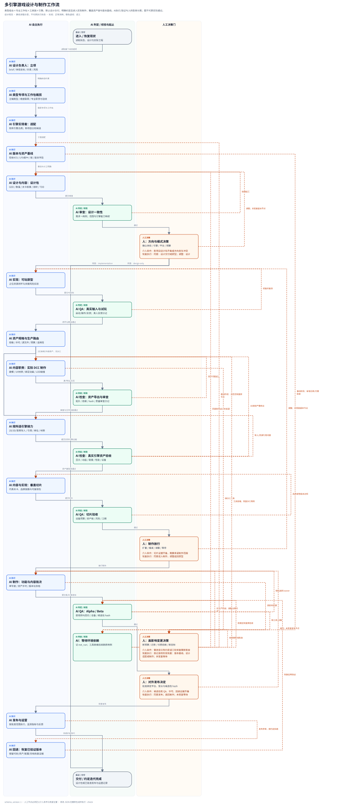

# Game Design：多引擎游戏设计 Manifest

用于把游戏想法变成可评审的设计包，并在明确约定后推进到可玩原型、垂直切片、制作、测试、发布和运营。不是一个假定所有引擎共用 API 的空工程模板，也不承诺一键生成完整游戏。

## 安装

```bash
vibe init game-design ./my-game
vibe add manifest game-design ./existing-game
# 直接安装；仅 Python 3.10+ 与 Bash，无第三方依赖
bash manifests/game-design/scripts/init-game-design.sh './my game' --dry-run
bash manifests/game-design/scripts/init-game-design.sh './my game'
```

安装复制工作流，不安装游戏引擎、不创建运行时工程、不改游戏资源、不发布。没有必需外部 skill，避免非 Unity 项目被迫装 Unity 包。CLI 对新模板 dry-run 只展示调用，精确文件预览用上面的直接脚本。引擎在安装后记录，不使用未映射的 `vibe --scenario` 参数。

默认逐文件保留已有文件；`--force` 仅刷新本安装器 ledger 中登记的模板资源，覆盖前在 `.game-design/backups/<id>/` 保存原件和可运行 restore.py。state/ 与 deliverables/ 从不强制覆盖。已有根 CLAUDE.md/AGENTS.md 即使首次 `--force` 也保留；按提示手工合并入口。目标包 README 不覆盖游戏自己的 README。

```text
CLAUDE.md / AGENTS.md                项目入口（相同契约）
.game-design/
  README.md
  references/lifecycle.md            阶段、验收与人工决策
  references/adapter-contract.md     引擎适配协议
  references/engines.json            23 项单一事实源
  references/engine-matrix.md        生成的覆盖矩阵
  references/adapters/*.md           按需加载的引擎细则
  references/workflow.json / .svg    可编辑源 / 人机流程图
  scripts/game_design.py             只读检测/查询/状态检查与文档生成
  scripts/render_workflow.py         零依赖流程图渲染/漂移检查
  templates/                        设计/数值/测试/发布模板
  state/                            项目状态、类型/任务范围、版本、决策、证据（用户数据）
  deliverables/                      已填写的设计包与后续产物
```

## 引擎覆盖

完整细则见 [覆盖矩阵](references/engine-matrix.md)，数据见 [engines.json](references/engines.json)。

| 分组 | 已登记适配器 |
|---|---|
| 通用编辑器 | Unity、Unreal Engine、Godot、Cocos Creator、O3DE、Stride |
| Web 游戏/渲染 | Phaser、PixiJS、Three.js、Babylon.js、PlayCanvas |
| 低代码 | GameMaker、Construct 3、GDevelop |
| 叙事/RPG | Ren'Py、RPG Maker MZ/MV |
| 代码优先 | Defold、LÖVE、MonoGame、libGDX、Bevy、raylib |
| 平台型 | Roblox Studio |

**覆盖级别为 design-adapter**：场景/实体、脚本/数据、资源管线、坐标/输入、存档/联网、测试、导出和风险均有映射。PixiJS/Three.js/raylib 等是渲染库/框架，不伪装成自带完整玩法工具链的编辑器。此模板的 23 项运行时验证初值均为 `not_run`，真实运行结果只在具体项目证据中填写。官方资料核验日期为 2026-11-03，不锁定“最新版本”；以已有项目和官方对应版本文档为准。

## 游戏类型、专业领域与细工作包

当前目录覆盖 **32 类可组合玩法、19 个专业领域、94 个细工作包**。

“引擎”只是一个适配轴。完整配置为 **游戏类型组合 × 表现维度 × 联网方式 × 平台/输入 × 内容生产链 × 引擎**：例如 3D 在线合作生存＋建造＋肉鸽，需要合并三类专项并处理规则冲突，而不是创建一个新引擎模板。

- [游戏类型专项](references/genres.md)：每类提供核心循环、细系统、设计交付、可观察验收和风险；支持主/辅类型组合。
- [粗细工作包目录](references/production.md)：立项、系统/数值/战斗AI、关卡叙事、2D/3D、绑定动画、材质灯光VFX、音频/UI、工程/联网、测试发布、运营和版本协作。每包都有输入→操作→产物→验收→依赖→返工。
- [建模与资源链](references/modeling.md)：规格、真实DCC、拓扑/UV/PBR、绑定动画、LOD/碰撞、导出、引擎接力与审查；非3D项目按实际资产链执行，不强制建模。
- [版本管理](references/version-management.md)：Git/LFS或Perforce选型、源/缓存、分支/锁/审查/CI、游戏/内容/存档版本、发布tag与回退。
- [技能与外部工具路由](references/tool-routing.md)：复用已有 Unity/DCC/游戏测试/版本技能，按项目加载；不宣称这些工具已经连接或运行。

安装后查询具体环节，不必把整个目录塞入上下文：

```bash
python3 .game-design/scripts/production_tools.py genres
python3 .game-design/scripts/production_tools.py areas
# 从上述列表取得稳定ID后查询；示例中的ID需按实际目录选择
python3 .game-design/scripts/production_tools.py genre --id roguelike
python3 .game-design/scripts/production_tools.py work --area modeling
python3 .game-design/scripts/production_tools.py check-production
python3 .game-design/scripts/production_tools.py render-production --check
```

在 state/project.json 中填写 genres（可组合ID）、dimension、multiplayer、content_pipeline；在 state/work.md 登记适用工作包及不适用理由。旧项目缺少新增配置字段时仍可读取，升级不会覆盖现有状态；按新模板补齐配置即可。

## 建模与版本工具

安装器将既有 canonical dcc_cli.py 和 Blender/export_model.py 原样分发，并在 install.json 记录来源与hash；不维护第二份建模实现。安装后的工具不依赖仓库相对路径。直接安装源码需要完整仓库中的 unity-game 这两个canonical文件；缺文件会在写入前报错。

```bash
python3 .game-design/scripts/dcc_cli.py doctor --output-dir Evidence/dcc-doctor-001
# 已有模型：副本导出与基础审计，不等于新建模型
python3 .game-design/scripts/dcc_cli.py run --project Art/source/model.blend --script .game-design/templates/Blender/export_model.py --output-dir Evidence/model-export-001
# 新模型：create_model.py须为按规格编写的真实DCC制作脚本
python3 .game-design/scripts/dcc_cli.py run --new --script Art/create_model.py --output-dir Evidence/model-create-001
python3 .game-design/scripts/asset_checks.py --project . --manifest .game-design/deliverables/assets.json
python3 .game-design/scripts/version_check.py --project .
```

DCC输出目录必须全新，源文件保留，日志与hash可追踪；缺工具记录 not_run。assets.json由模板复制后填写，用于核验源/导出hash、许可和审查引用；其 `files_verified` 只表示本地文件与证据引用齐备，不重演审查、不证明模型审美或引擎行为。version_check仅检查本地Git/LFS信号及版本元数据，未采用Git的项目按版本策略选择P4/快照；不初始化仓库、不改ignore、不获取锁、不推送。

## 首次使用

可对代理说：

> 使用 game-design 设计这款游戏。先看现有工程和资料，明确体验支柱、核心循环、目标平台、团队与工期。引擎未定时比较候选；已有工程保持原引擎和版本。先交付 GDD、系统/关卡/叙事、视听 UI、技术映射与试玩验收计划，方向由我确认后再决定是否进入原型。

安装后从项目根运行：

```bash
python3 .game-design/scripts/game_design.py list
python3 .game-design/scripts/game_design.py detect --project .
python3 .game-design/scripts/game_design.py adapter --engine godot
python3 .game-design/scripts/game_design.py check-project --project .
```

detect 只看所指定根的有限文件/依赖，单一命中返回 0；多命中 ambiguous、无命中 unrecognized 返回 1；无目录或非法输入返回 2。自定义依赖别名、深层 monorepo、vendor-only、云 Editor 工程需显式定位/选择；线索不代表完整语义解析。模板目录本身含多个引擎示例，不将其当游戏工程。

填写 state/project.json：engine 使用 list 中 ID，engine_version 记录实际版本，targets 填目标平台，budgets 填帧时/内存/下载体积。未定保持 null/空串，并记录待决，不用伪值通过检查。check-project 返回 1 表示 pending，0 仅代表配置齐备，绝不是游戏或发布验收。

## 设计产物与流程

复制所需 templates 到 deliverables 后填写，不直接用占位模板当交付。覆盖 brief、GDD、系统/经济数值 CSV、关卡、叙事、视听/可访问性、引擎决策、技术设计、原型/试玩、制作/发布和需求追踪。模式默认为 design-only；implementation 模式才进入开发链。

[阶段契约与验收](references/lifecycle.md) · [适配协议](references/adapter-contract.md) · [工作流源](references/workflow.json)



图表示规则而非当前进度；AI 执行、AI 验证与人工决策分泳道，包含返工、等待、回退与恢复点。

## 生成与检查

以下命令在 **安装后项目根** 运行：

```bash
python3 .game-design/scripts/game_design.py check-catalog
python3 .game-design/scripts/production_tools.py check-production
python3 .game-design/scripts/production_tools.py render-production --check
python3 .game-design/scripts/game_design.py render-adapters --check
python3 .game-design/scripts/render_workflow.py --source .game-design/references/workflow.json --output .game-design/references/workflow.svg --check
```

修改 genres.json / production.json 后运行 `python3 .game-design/scripts/production_tools.py render-production`，再用相同命令加 `--check` 校验。

修改 engines.json 后先运行 `render-adapters`（不带 --check）；修改 workflow.json 后运行对应渲染命令（不带 --check）。所有 check 模式只读，缺文件或漂移返回非零，不自动修复。源码仓库中把命令前缀 `.game-design/` 换成 `manifests/game-design/`。

源码测试：

```bash
PYTHONPATH=tools/vibe_tool/src PYTHONDONTWRITEBYTECODE=1 python3 -m unittest discover -s manifests/game-design/tests -v
```

## 升级与回退

使用 `vibe add manifest game-design ./my-game --force` 或直接 init 脚本 `--force` 刷新本模板管理的资源。自定义模板资源也会被显式 force 覆盖，请先比较备份；项目状态、交付物、实际游戏资产保留。不要假定通用 `vibe update manifest` 会同步本模板的任意 payload。

安装器进程内异常会恢复已写路径；强制刷新后可执行其打印的 `python3 .../restore.py`，恢复该次更改。恢复会拒绝覆盖刷新之后的新编辑；先人工处理冲突再重试。中断/断电后检查 backups 中 transaction.json 与原件，先恢复再重新安装。已有其他 manifest 的根入口需要合并，Unity 专项实现可继续使用独立 unity-game，不由本模板迁移。
