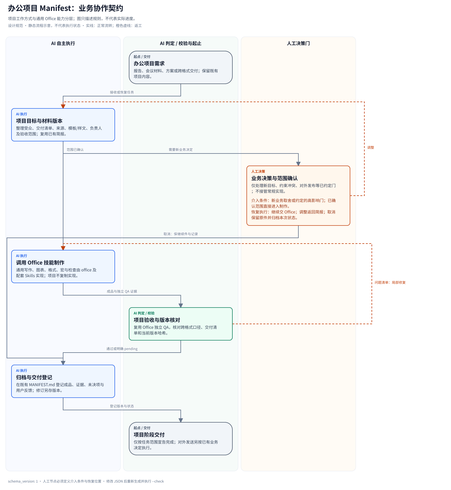

# 办公项目 Manifest

把报告、会议材料、方案等办公交付组织成可追溯项目：管理目标、材料来源、样文/模板、跨格式版本、验收与归档。Word/Excel/PowerPoint/PDF 的通用能力由 **Office Skill** 提供；单次文件任务直接安装 Skill，无需建立办公项目。

## 开始使用

前提：本地技能来源已就绪，已配置 vibe 仓库。新项目：

```bash
vibe init office "./office project"
```

预期得到项目协作入口、`office/` 项目说明与工作流、`.agents/skills/office/` 及配套技能；实际文件任务由 Office Skill 按需执行。初始化不运行宏、不启动模型服务、不改全局配置。

已有项目先预览再安装；既有入口和文件默认保留：

```bash
vibe add manifest office "./existing project" --dry-run
vibe add manifest office "./existing project"
```

若根指令被保留，在其中加入：**办公项目任务先读 `office/README.md`，文件制作加载 `.agents/skills/office/SKILL.md`。**

只需要办公能力，而不是项目模板：

```bash
vibe add skill office "./existing project"
```

该命令只复制 Office Skill；配套写作、绘图和格式技能通过现有环境发现或按需另装，不隐式递归安装。

## 两层职责与安装布局

| 层 | 负责内容 | 唯一来源 |
| --- | --- | --- |
| 办公项目 Manifest | 目标、来源/版本、业务决定、交付清单、反馈与归档 | 本模板 |
| Office Skill | 通用办公路由、格式指南、原生功能/宏、工具、角色源和验收 | `mine/office/`（仓库位置） |
| 配套 Skills | 正文/样文、图片、表格、演示设计、格式引擎与质量审查 | 各技能自己的包 |

项目中 `office/` 仅含项目说明、简报模板、业务规则与工作流再生成资源；通用指南/工具位于 `.agents/skills/office/`。`skills.txt` 显式声明 Office 和九项配套依赖，缺来源会返回非零。原生 Claude/Codex 角色从 Office Skill 的同一份源安装到宿主目录，单独安装 Skill 不注册这些角色。

[项目简报模板](templates/task-brief.md)。产物仍追加至项目根 MANIFEST.md；不写进已安装技能。

## 项目工作流



[可编辑 JSON 源](assets/workflow.json) · [标准库渲染器](scripts/render_workflow.py)。安装后从项目根目录执行：

```bash
python office/scripts/render_workflow.py --source office/assets/workflow.json --output office/assets/workflow.svg
python office/scripts/render_workflow.py --source office/assets/workflow.json --output office/assets/workflow.svg --check
```

在本模板源码目录中运行时，将命令中的 `office/` 前缀去掉。图描述规则，不表示实际制作、用户决定或 QA 已完成。

## 已有 Office 项目的更新

旧版项目先安装新能力，再更新契约：

```bash
vibe add skill office "./existing project"
vibe update manifest office "./existing project" --dry-run
vibe update manifest office "./existing project"
```

更新保留项目数据、README 和产物账本；未安装的其他依赖仍按现有 update 语义跳过。旧 `office/docx` 等目录不会被自动删除，也不覆盖其中的用户内容；新任务读取 Skill 内的新路径。旧项目若自行定制了入口，应同步调整其读取位置。资源更新生成备份与独立恢复命令，按实际打印路径回退。

宏源码、宏包保留、真实应用编译/执行分别验收；安装 Office Skill 不代表当前环境已有 Microsoft Office。具体能力、限制和调用入口以已安装 Office Skill 为准。
