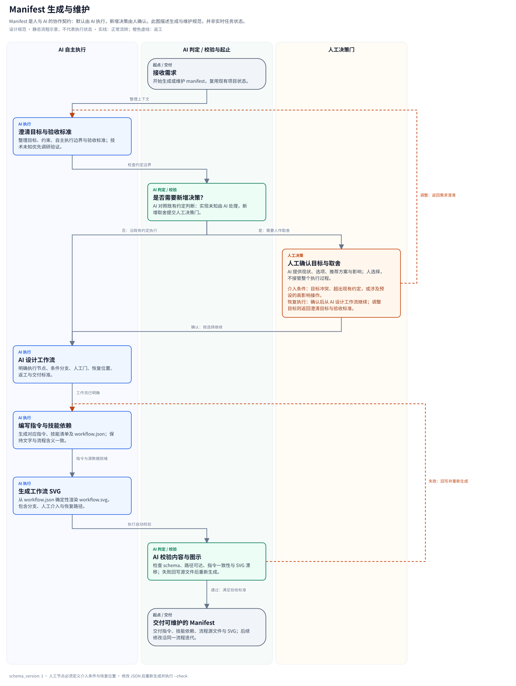

# Manifest 工作流图交付规范

Manifest 是人与 AI 的协作契约。新建 manifest，或修改既有 manifest 的执行阶段、角色路由、验收条件、人工决策规则时，**同步交付对应的 workflow SVG、可编辑源、生成命令和一致性检查**，而不是仅生成指令文件。

原则：**默认由 AI 执行；需要新增人的决策时才请求介入；人确认后由 AI 从明确的恢复点继续。** 技术实现存在不确定性时，先由 AI 调研、实验和验证；目标冲突、约定变更或预设高影响边界才触发人工决策。

## 1. 必需交付物

推荐布局：

```text
manifests/<name>/
├── CLAUDE.md
├── AGENTS.md                     # 如模板提供，保持双端规则一致
├── README.md                     # 链接 SVG、图源和复现命令
├── references/
│   ├── workflow.json             # 可编辑源，或复用已有规范数据
│   └── workflow.svg              # 真实、可直接打开的矢量图
└── scripts/
    └── render_workflow.py         # 可复现的渲染入口
```

- **SVG**：展示本 manifest 的真实流程，而非一张所有模板共用的通用示意图。文本保留为文本，提供标题、描述、图例和有向连接。
- **可编辑源**：可采用 JSON、Mermaid、DOT 或既有机器可读目录。一个事实来源即可；Unity 已有 `skill-map.json`，继续复用，无需另维护重复 JSON。
- **生成入口**：记录依赖、输入、输出和精确命令；优先确定性生成。修改图源后重新生成 SVG，不以手工编辑生成文件作为维护方式。
- **入口说明**：README 或主指令文件链接图与源，说明阶段输入、产物、验收标准、角色/skill 路由及人工介入条件。已有文字契约可以复用。
- **一致性检查**：提供只读的漂移检查，缺图、源与图不一致或引用失效时返回非零状态。

只更新无关措辞时不强制重画。新增或修改工作流时补齐这些交付物；保留现有模板的有效命名和生成方式，不为统一文件名批量迁移。

## 2. 图上需要表达什么

| 元素 | 必须明确的内容 |
|---|---|
| 起点与完成点 | 请求怎样进入流程，达到什么验收标准后结束 |
| AI 执行 | 阶段、执行角色或 skill、输入及主要产物 |
| AI 验证/审查 | 测试或独立审查标准，通过和失败各去哪里 |
| 人工决策 | 触发条件、需要人决定的问题、决定后的恢复节点 |
| 返工与等待 | 失败回到哪个 owner；等待依赖与等待人作决策分别标注 |
| 回退 | 有状态修改的恢复入口及触发条件；根据实际流程画出，而非伪造已成功的回退 |

人工确认与 AI 审查使用不同节点样式或泳道，同时配文字标签，避免只靠颜色区分。确认节点至少有“同意/继续”和“调整/退回”的明确去向；人尚未决定时保持等待，不自动视为同意。

实现层面的失败优先进入 AI 返工闭环；反复失败达到项目约定的升级条件，或需要改变目标/风险取舍时，再交给人决策。人工介入解决当前决策，不把后续实现工作整体交回给人。

**图表示流程规范，不代表节点已经执行、测试已通过或人工已经批准。** 实际进度、证据、revision 和批准记录仍保存到项目的状态或交付记录中。图与文字相互校对：阶段、角色、分支条件及人工介入边界应一致。图本身不替代运行时控制。

## 3. 零依赖参考工具与真实示例

本仓库提供 Python 标准库参考渲染器，以及描述 **Manifest 生成与维护** 的示例。这张图对应的是 manifest 创作流程；创建业务模板时应将节点和边替换为该业务的真实流程。



- [可编辑 JSON 源](examples/manifest-workflow/workflow.json)
- [SVG 文件](examples/manifest-workflow/workflow.svg)
- [独立渲染器](../scripts/render-manifest-workflow.py)
- [成熟业务实例：Unity 工作流](../manifests/unity-game/references/workflow.svg)

从仓库根目录生成和检查示例：

```bash
python3 scripts/render-manifest-workflow.py \
  --source docs/examples/manifest-workflow/workflow.json \
  --output docs/examples/manifest-workflow/workflow.svg

python3 scripts/render-manifest-workflow.py \
  --source docs/examples/manifest-workflow/workflow.json \
  --output docs/examples/manifest-workflow/workflow.svg --check

PYTHONDONTWRITEBYTECODE=1 python3 -m unittest discover \
  -s tests -p 'test_manifest_workflow.py' -v
```

复用到新模板时，可将渲染器复制到 `manifests/<name>/scripts/render_workflow.py`，再建立该模板自己的 `references/workflow.json`。使用显式源和输出参数，避免依赖当前工作目录：

```bash
python3 manifests/<name>/scripts/render_workflow.py \
  --source manifests/<name>/references/workflow.json \
  --output manifests/<name>/references/workflow.svg
# 校验时使用同一命令，并追加 --check。
```

### 参考 JSON 契约

顶层字段为 `schema_version: 1`、`title`、`description`、`nodes` 和 `edges`。

| 对象 | 字段 |
|---|---|
| node | `id`、`label`、`kind`、`row`、`detail` |
| human node | 额外包含 `trigger`（介入条件）和 `resume`（恢复说明） |
| edge | `from`、`to`、`label`、`kind` |

- 节点 `kind`：`ai`、`check`、`human`、`terminal`。分别进入 AI、验证、人工三个泳道，起止节点位于验证泳道。
- `row` 是从零开始的非负整数；同泳道同一行只放一个节点。图源同时保存布局，保持再生成稳定。
- ID 使用 `[A-Za-z_][A-Za-z0-9_-]*`，边必须引用已有节点；所有节点应在唯一起点至唯一终点的可达路径上。
- 边 `kind`：`normal` 或 `rework`；允许返工闭环，连接标签明确条件。
- 标题与说明使用非空文本；具体长度和布局限制由渲染器报错提示。

工具生成成功返回 `0`；`--check` 在图缺失或漂移时返回 `1`；无效源数据或参数返回 `2`。检查模式不创建目录、不改写文件。正常生成使用临时文件加 `os.replace` 原子替换。

这些校验检查结构与生成一致性；“图是否准确描述业务”“人工边界是否合理”仍需结合 manifest 文字与测试审查。

## 4. 安装、转换与维护

本规范覆盖 **manifest 的创作交付**，不表示所有旧模板都已补图，也不改变 `vibe init/add/update` 的安装策略。

若模板承诺在目标项目中提供图和再生成能力，其安装器应显式分发 SVG、源数据和渲染入口，并测试安装后的链接与再生成命令。通用安装器目前不自动复制任意 `references/` 目录；具体分发位置由模板约定。

Manifest 转为 skill 时保留图、源和生成依赖，更新相对链接，避免出现只有 SVG 而缺少源数据的包。源数据位于另一个 skill 包时，记录依赖并验证安装后的路径。

### 完成检查

- [ ] 图对应当前 manifest，而非未改写的示例。
- [ ] 指令、角色、skill 路由、阶段与图一致。
- [ ] AI 执行、AI 验证、人工决策可明确区分。
- [ ] 条件分支、返工、等待、必要回退及人工确认后的恢复路径完整。
- [ ] SVG 可解析，可在常见查看器阅读；文字未裁切，箭头和标签可辨。
- [ ] 源、渲染依赖和命令齐全；再次生成稳定；漂移检查通过。
- [ ] README/指令中的图、源和命令链接可用。
- [ ] 如承诺安装/转换分发，已在目标包内验证图和源均可用。
