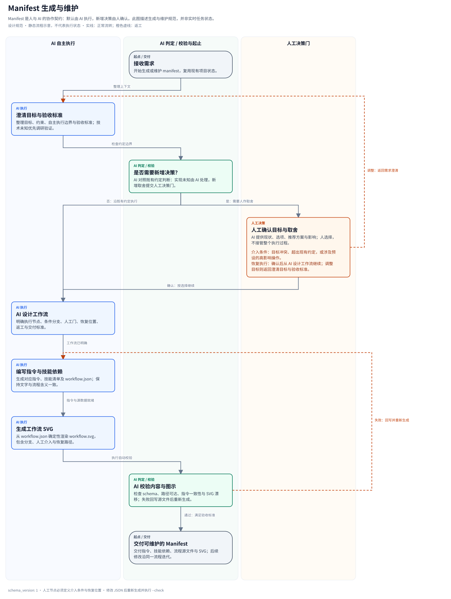

# Manifest Workflow Deliverables

[简体中文](manifest-workflow.md) | **English**

A Manifest is a human–AI collaboration contract. When creating a Manifest or changing its execution stages, role routing, acceptance criteria, or human-decision rules, **deliver the corresponding workflow SVG, editable source, rendering command, and consistency check**, not only instruction files.

Principle: **AI executes by default; involve a human when a new human decision is needed, then resume AI work from an explicit point.** AI investigates, experiments, and validates technical uncertainty first. Conflicting goals, changed agreements, or predefined high-impact boundaries trigger human decisions.

## 1. Required deliverables

Suggested layout:

```text
manifests/<name>/
├── CLAUDE.md
├── AGENTS.md                     # Keep both agent contracts aligned when provided
├── README.md                     # Link the SVG, source, and reproduction command
├── references/
│   ├── workflow.json             # Editable source, or existing canonical data
│   └── workflow.svg              # A real vector image that opens directly
└── scripts/
    └── render_workflow.py         # Reproducible rendering entry point
```

- **SVG:** depict this Manifest's actual workflow, not a generic illustration reused unchanged for every template. Preserve text as text; include a title, description, legend, and directed connections.
- **Editable source:** JSON, Mermaid, DOT, or an existing machine-readable catalog may be used. Keep one source of truth. Unity already has `skill-map.json`; reuse it rather than maintaining duplicate JSON.
- **Generation entry point:** record dependencies, inputs, outputs, and the exact command; prefer deterministic rendering. Regenerate the SVG after changing the source instead of manually editing generated output.
- **Entry-point documentation:** link the diagram and source from README or the main instructions. Explain stage inputs, outputs, acceptance criteria, role/skill routing, and human-intervention conditions. Reuse existing written contracts.
- **Consistency check:** provide a read-only drift check that returns nonzero for a missing diagram, source/output mismatch, or invalid reference.

Unrelated wording edits do not require redrawing. New or changed workflows need these deliverables. Keep existing valid names and renderers rather than migrating all templates to uniform filenames.

## 2. What the diagram must express

| Element | Required information |
| --- | --- |
| Start and completion | How a request enters and which acceptance criteria end the workflow |
| AI execution | Stages, execution roles or skills, inputs, and main outputs |
| AI validation/review | Test or independent-review criteria and both pass/fail destinations |
| Human decisions | Triggers, the decision needed, and the resumption node |
| Rework and waiting | Which owner receives failed work; distinguish dependency waits from human-decision waits |
| Rollback | Recovery entry points and triggers for state-changing operations, reflecting actual capabilities rather than invented successful recovery |

Use different node styles or lanes for human decisions and AI review, with text labels rather than color alone. A decision node needs explicit continue/accept and adjust/return paths. Remain waiting while the human has not decided; silence is not agreement.

Implementation failures normally enter the AI rework loop. Escalate after the project's agreed repeated-failure threshold, or when goals/risk tradeoffs need changing. Human involvement resolves the current decision; it does not transfer all later implementation work back to the human.

**The diagram specifies workflow rules, not evidence that nodes ran, tests passed, or a human approved.** Keep actual progress, evidence, revisions, and approvals in the project's state/delivery records. Cross-check stages, roles, branch conditions, and human boundaries against the written contract. The diagram itself is not a runtime control.

## 3. Dependency-free reference tools and a real example

This repository provides a Python-standard-library renderer and an example of **Manifest creation and maintenance**. The example describes Manifest authoring; a business template needs nodes and edges for its own actual workflow.



- [Editable JSON source](examples/manifest-workflow/workflow.json)
- [SVG file](examples/manifest-workflow/workflow.svg)
- [Standalone renderer](../scripts/render-manifest-workflow.py)
- [Established business example: Unity workflow](../manifests/unity-game/references/workflow.svg)

Generate and check the example from the repository root:

```bash
python3 scripts/render-manifest-workflow.py \
  --source docs/examples/manifest-workflow/workflow.json \
  --output docs/examples/manifest-workflow/workflow.svg

python3 scripts/render-manifest-workflow.py \
  --source docs/examples/manifest-workflow/workflow.json \
  --output docs/examples/manifest-workflow/workflow.svg --check

PYTHONDONTWRITEBYTECODE=1 python3 -m unittest discover \
  -s tests -p 'test_manifest_workflow.py' -v
```

For a new template, copy the renderer to `manifests/<name>/scripts/render_workflow.py`, then create that template's `references/workflow.json`. Use explicit source/output arguments instead of depending on the current working directory:

```bash
python3 manifests/<name>/scripts/render_workflow.py \
  --source manifests/<name>/references/workflow.json \
  --output manifests/<name>/references/workflow.svg
# Use the same command with --check for validation.
```

### Reference JSON contract

Top-level fields are `schema_version: 1`, `title`, `description`, `nodes`, and `edges`.

| Object | Fields |
| --- | --- |
| node | `id`, `label`, `kind`, `row`, `detail` |
| human node | Also `trigger` (intervention condition) and `resume` (resumption instructions) |
| edge | `from`, `to`, `label`, `kind` |

- Node `kind`: `ai`, `check`, `human`, or `terminal`. Nodes use AI, validation, and human lanes; start/end nodes use the validation lane.
- `row` is a nonnegative integer starting at zero. One node occupies each lane/row cell. Layout is part of the source for stable regeneration.
- IDs follow `[A-Za-z_][A-Za-z0-9_-]*`; edges reference existing nodes. Every node must be on a reachable path from the unique start to the unique end.
- Edge `kind`: `normal` or `rework`. Rework cycles are allowed; connection labels state conditions.
- Titles/descriptions use nonempty text. The renderer reports detailed length and layout limits.

Successful generation returns `0`; `--check` returns `1` for missing/drifted output; invalid source data or arguments return `2`. Check mode creates no directories and changes no files. Normal generation uses a temporary file followed by atomic `os.replace`.

These checks validate structure and generation consistency. Whether the diagram accurately describes the business process and uses appropriate human boundaries still requires review against the Manifest text and tests.

## 4. Installation, conversion, and maintenance

This specification covers **Manifest authoring deliverables**. It does not assert that all legacy templates already include diagrams, and it does not change `vibe init/add/update` installation policy.

If a template promises diagrams and regeneration in the target project, its installer must explicitly distribute the SVG, source data, and renderer, and test installed links and regeneration commands. The generic installer does not automatically copy arbitrary `references/` directories; each template defines distribution locations.

When converting a Manifest to a Skill, retain the diagram, source, and rendering dependencies, and update relative links. Avoid a package containing only SVG without its source. If source data lives in another Skill package, record the dependency and validate installed paths.

### Completion checklist

- [ ] The diagram describes the current Manifest rather than an unchanged example.
- [ ] Instructions, roles, skill routing, stages, and diagram agree.
- [ ] AI execution, AI validation, and human decisions are distinguishable.
- [ ] Conditional branches, rework, waiting, required rollback, and post-decision resumption paths are complete.
- [ ] SVG parses and is readable in common viewers; text is not clipped, and arrows/labels are legible.
- [ ] Source, renderer dependencies, and commands are complete; regeneration is stable; drift checks pass.
- [ ] Diagram/source/command links in README or instructions work.
- [ ] Where installation/conversion distribution is promised, verify the diagram and source in the target package.

## 5. Runtime human–AI interaction contract

The Manifest defines business-level intervention semantics. The harness/host presents questions, receives answers, sends notifications, handles interruptions, and restores sessions. Scripts and tool entry points check actual versions, resources, and execution state. Markdown and diagrams are collaboration agreements; structural validation is neither identity authentication nor sandbox-level enforcement.

### Interaction types and modes

- **Clarification/co-creation:** collect goals, preferences, experience, and intuitions. An ordinary answer does not automatically become business approval. When the user requests joint exploration, interaction is itself the work; for an explicit execution task, reuse confirmed inputs rather than repeating an interview.
- **Business decisions:** choose a plan, accept an artifact version, or approve a budget/external action; bind the decision to a specific object and scope.
- **Tool permissions:** use the host's command, file, and network permission mechanisms. Permission to use a tool does not mean its related business decision has been approved.
- **Intervention during execution:** distinguish queuing the next task, correcting the current task, and stopping. Recheck goals and actual state after intervention. Reverse completed actions through the existing business entry point; stopping generation is not successful rollback.

Business templates distinguish collaborative exploration from delegated execution according to the request. They neither force every task through questions nor reduce all human participation to a final approval.

### What each interaction point must specify

Reuse existing `trigger`, `resume`, stage IDs, and project ledgers. The following are semantic checks, not a requirement to introduce a universal state schema:

| Item | Required semantics |
| --- | --- |
| Trigger and type | Why this human input is needed now, and who owns the decision |
| Decision materials | Specific artifact, version/hash, evidence, resource units/limits, options, and consequences |
| Waiting scope | Which actions pause without an answer, and which independent tasks may continue; timeout is not agreement |
| Answer provenance | Original text supplied by the host, or a message/approval-event reference; record ordinary answers, tool permissions, and business approvals separately |
| Validity scope | Which object and stage the answer concerns, and which material changes invalidate it |
| Resumption and branches | Accept, adjust, and cancel destinations; verify versions and actual processes/artifacts before resuming |
| Duplicate handling | Reuse existing decisions and execution records for repeated answers, reconnections, and replay, avoiding duplicate external actions |

### Host mapping and boundaries

Check the tools, modes, and interfaces actually exposed by the current host rather than inferring an API from a model name. Use native question/approval interfaces when structured input is available. With chat alone, provide clear decision materials and wait for an actual answer that can be referenced. In unattended execution without a currently valid decision, save a waiting state rather than inventing an answer. This general specification does not fix tool names such as `AskUserQuestion` or `request_user_input`; host-adaptation details belong in each business template's own integration contract.

Default selections, automatic timeouts, and cleared native-question requests do not automatically grant business approval. For high-impact actions, the host supplies actual response provenance and the execution entry point checks current validity. Writing an approval field into local JSON does not authenticate the human. Session restoration only restores conversational context; business resumption still reads the project ledger and checks external state.

Keep one source of business truth. Do not create a second universal approval database or treat SVG as a runtime. Explicitly version machine-readable decision records; user confirmation is needed for legacy-project migration, and template updates preserve existing project data. See the [Auto-Research budget interaction pilot (Chinese)](../manifests/auto-research/references/human-interaction.md) and its distributed workflow diagram.
