# Office Manifest

质量优先的 DOCX、XLSX、PPTX、PDF 工作流：现有文档 skills 负责格式引擎，一方 `office-quality` 负责验收、文件保护和交接，八个专业 subagents 负责制作与独立审查。`office-writer` 使用 `ai-vibe-writing` 主动学习样文并迁移文风，`office-visuals` 将正文与图表/素材共同规划；DOCX 格式 skill 负责原生文件工程、模板/宏排版和实际约束验证。默认输出原生可编辑文件；CSV 用于数据交换。演示先走 Omnippt 的内容与设计分层；图片/绘图统一先走 Omnidraw，表格/工作簿统一先走 Omnisheet，再由格式工程师写入最终原生文件。



## 安装与已有项目接入

在已配置此技能仓库的环境中：

```bash
vibe init office "./office project"
vibe add manifest office "./existing project" --dry-run
vibe add manifest office "./existing project"
```

重复安装保留已有文件并报告跳过项；只有显式 `--force` 才更新冲突文件。`--dry-run` 仅预览，保持文件系统零写入且不创建目标目录。安装不自动建立 Git 分支、提交或安装系统依赖。

本说明源文件位于 `manifests/office/README.md`；安装后的稳定位置是 `office/README.md`。下文命令及引用均相对**目标项目根目录**，而非当前 README 所在目录。仓库内的格式指南与资源位于 `manifests/office/` 下，安装器会将其完整复制到目标 `office/`。

若目标已有 `CLAUDE.md` / `AGENTS.md`，保留原有指令，在项目入口手动加入：

> 办公文件任务先阅读 `office/README.md`、`office/rules/quality.md`、`office/rules/file-safety.md` 和 `.agents/skills/office-quality/SKILL.md`，按格式加载 `office/<format>/CLAUDE.md`、`office/rules/<format>.md` 与对应文档 skill。新建/编辑完成后派发独立 `office-qa` 审查。

这也是不覆盖既有入口的推荐接入方式。若某个受管文件被跳过，核对该文件是否仍符合本版要求；使用 `--force` 前保留所需本地定制。

## 安装布局

```text
CLAUDE.md / AGENTS.md                  # 新项目入口；已有文件默认保留
.agents/skills/office-quality/         # 自包含质量编排 skill
.agents/skills/ai-vibe-writing/        # 正文写作/润色层，含上游 .ai_context 模板
.agents/skills/omnidraw/               # 图片、示意图及数据绘图入口
.agents/skills/omnisheet/              # 表格/数据模型/布局与工作簿入口
.agents/skills/omnippt/                # PPT设计主技能、六子技能及按需模板
.agents/skills/anthropics-skills-*/     # docx、xlsx、pptx、pdf 精确来源安装
.claude/agents/office-*.md              # 八个 Claude Code 角色
.codex/agents/office-*.toml             # 八个 Codex 原生角色
.cursor/rules/                        # Office .mdc 规则
office/
   README.md                          # 本文，稳定接入点
   assets/workflow.svg                 # 文档中的工作流示意图
   docx/ xlsx/ pptx/ pdf/ planning/    # 格式/规划指南、按需专利参考、表格脚本
   rules/ agents/ scripts/            # 共享规则、角色源说明、辅助检查
```

`skills.txt` 声明四个精确来源 `anthropics/skills/{docx,xlsx,pptx,pdf}`，以及 `office-quality`、`ai-vibe-writing`、`omnidraw`、`omnisheet`、`omnippt`，共九项。上游子模块缺失时先按安装提示初始化所需来源，再重试；不把同名不同来源 skill 静默当成依赖。稳定目录名不随其他子模块是否初始化而变化。

## DOCX 正文写作与文件工程分层

[AI Vibe Writing Skills](https://github.com/donghuixin/AI-Vibe-Writing-Skills) 作为正文写作层，安装入口为 `.agents/skills/ai-vibe-writing/SKILL.md`；生成/编辑 DOCX、样式、分页、对象保真和渲染仍由 DOCX 格式 skill 与 Office 质量门禁处理。

- 新正文或实质润色：按任务选择大纲、Content Writer / Writer、Content Review，必要时用 Sentence Flow 检查句段衔接；普通办公文档不因此强制运行完整学术写作流程或全部 18 个角色。
- 仅语法、拼写、标点：走 Grammar Checker 的最小纠错路径，保留原意和语气，不扩写为重写或研究审计。
- 指定文风时主动调用上游 Style Extractor，记录样本来源/归属和体裁，在用户项目 `.ai_context/style_profile.md` 学习语气、语域、句子节奏、用词、论证顺序与意象；保留短正反例，写作者/审阅者对照迁移效果，不用检测器评分。外部参考与用户个人习惯区分，事实与引文仍依真实来源。
- 上游 `.ai_context/` 提示词及模板随 skill 捆绑，保持其相对链接；任务的规范、风格、稿件和记忆实例放在**当前用户项目**的 `.ai_context/`（或沿用项目已有位置），不写进已安装 skill 目录。
- 大纲同时规划正文主张、数据/素材、图表类型、可编辑源、题注/替代文本与交叉引用；使用实际资产与原生 Word 表格，图表按目标应用能力选用原生/嵌入对象，不因 Python 接口缺口一律转图。无信息价值时不强制装饰。
- 写作自审不替代文档最终版本的全页预览与独立 `office-qa`。按需读 `office/docx/references/voice-and-visuals.md`，可复制 `office/docx/templates/content-brief.md`。

## 图片与表格入口

- 图片、插图、流程/结构图和数据绘图先读 `.agents/skills/omnidraw/SKILL.md`；包括 matplotlib 绘图在内，先由 Omnidraw 选择合适子路径，再交付真实素材、来源/数据、编辑源、题注与替代文本。
- 所有表格、表格数据模型/布局及 XLSX 先读 `.agents/skills/omnisheet/SKILL.md`，按场景明确列/单位/公式/视图，再按需使用底层 XLSX skill。简单 Word/PPT 表格也经过该入口，但不额外生成未请求的工作簿。
- `office-visuals` 按需路由两者，`office-xlsx` 先用 Omnisheet 再用 XLSX 引擎；`office-docx` / `office-pptx` 仍是最终文件唯一写入者，依据已核对数据插入真正的原生表格/图表，不把表格转成图片。
- 路由技能按任务选择可用子能力，不意味着启动所有外部服务；保留同一数据来源与版本，独立 QA 核对素材/表格数据及最终成品。

## Excel 图表确认与宏

新增图表和宏使用分别向用户确认（yes/no/pending），复用已有明确答复；未答继续非图表/非宏工作，既有图表/宏默认保留。支持 VBA `.bas` / `.cls`、`.xlsm` / `.xltm` 的制作、保留、显式调用和实际验收；`.xlsx` 不承载 VBA，当前 `.xlsx` 重算/预览脚本不承担宏执行或保真转换。具体交互、调用范围、引擎与证据见 `office/xlsx/references/charts-and-macros.md`，记录模板见 `office/xlsx/templates/workbook-brief.md`。

## PPT：Omnippt 设计与原生交付

先读 `.agents/skills/omnippt/SKILL.md`。六个按需子技能为 `brief-research`、`story-outline`、`storyboard`、`visual-design`、`native-build`、`deck-review`，各有自己的 `SKILL.md`；它们是设计阶段而非新增 subagents，Office 仍为八个角色。

- 从受众、希望促成的行动/结论、材料与研究缺口出发；先准备能调整顺序的稳定 slide ID 大纲，再做不依赖视觉包装的朴素分镜，最后确定视觉语言。已有模板局部编辑直接复用已核对上下文，只计划本次变化，不强制新研究或完整六阶段文件。
- Bento/卡片是内容驱动的可选表达，不是每页固定矩阵；比较、证据、时间线、表格或纯文字各按信息关系选布局，不靠装饰/大字补内容。没有新素材/研究需求时不强行调用外部服务。
- `office-pptx` 独占最终演示文件，按 Omnippt `native-build/SKILL.md` 接底层 PPTX 引擎；Omnidraw 提供图片/图源，Omnisheet 提供表格与数据。默认正文、形状、表格和数据图表原生可编辑；保留源模板、母版、主题、备注和未修改页面。
- 新增数据图表与宏使用分别记录 yes/no/pending 及真实确认来源，已明确时不重复问；no/pending 不新增或重建图表，也不改成图片绕过。原图表与宏默认保留，保留不是执行许可。
- SVG 插入不自动变成原生文本/图形；转换为形状是另一步，需按真实 PowerPoint 版本和结果验收。`.bas` / `.cls` 源与 `.pptm` / `.potm` / `.ppsm` 宏包及实际 PowerPoint 编译/执行分开记录；当前通用检查/预览只覆盖 `.pptx`，不证明宏保真或执行。
- 交接 brief/来源、大纲、分镜、tokens/阶段版本、决定与源/最终哈希；合同检查只是设计结构证据，最终全页渲染和独立 QA 才决定交付状态。详见 `office/pptx/CLAUDE.md`，不默认接入 `ppt-master` 或固定 SVG 流水线。

## Word 原生排版与约束

按需使用样式/主题、多级编号、分节/页眉页脚、TOC/SEQ/REF、书签、题注、修订批注、内容控件、原生图表/OLE/SmartArt 与宏，而不是将某个格式库的接口限制写成全局禁令。把需求映射为原生对象/属性，并核对实际状态和渲染，例如标题样式的字体/KeepWithNext、表头重复/行跨页、固定标题内容控件的内容/删除锁定。只有用户要求时才限定可编辑区域或限制编辑，不默认锁文档或擅设密码；编辑保护不是加密保证。

宏可放在 `.dotm` 模板中排版普通 `.docx`，需要交付内保留宏时选 `.docm` / `.dotm`。宏文件的存在不自动触发执行。`office/docx/macros/OfficeLayout.bas` 提供 Word VBA 路径；Linux 可用 `office/docx/scripts/native_format.py --engine libreoffice` 的 UNO 路径，配合只读 `feature_audit.py` 检查最终原生特性。Word VBA 静态检查、LibreOffice UNO 执行及目标 Word 验证分别记录，不混称。完整能力与官方 API 引用见 `office/docx/references/native-formatting.md`。

## Word 公式与动态编号

数学内容保留可编辑 LaTeX/Markdown 源，最终 Word 使用原生 OMML，不静默转图片。图、表、公式分别使用独立 SEQ 自动序列，公式编号位于右侧；书签与 REF/PAGEREF 管理交叉引用，插入/删除/移动后按依赖顺序实际更新核验。复用模板中文标签/章编号，文献 CITATION/BIBLIOGRAPHY 与现有 Zotero 等字段保留原管理方式；详见 `office/docx/references/equations-and-fields.md`。

## 工作方式与验收状态

1. 明确受众、用途、格式、模板、来源、保留特性和验收条件；复杂/跨格式任务参考 `office/planning/CLAUDE.md`，简单任务保持轻量。
2. 只读依赖检查、记录输入哈希，基于副本制作。选用 `office/{docx,xlsx,pptx,pdf}/CLAUDE.md` 和对应共享规则。
3. 重新打开最终文件，检查结构、内容和关键值；XLSX 重算后验证公式缓存。格式转换后再次验收。
4. DOCX/PPTX/PDF 渲染并逐页审阅；XLSX 全表检查数据/公式，并审阅所有声明的交付打印区域。
5. 制作角色把最终文件、源/最终哈希、原始检查输出、预览和未决项交给独立 `office-qa`。问题由制作角色修复，再对新版本复验。
6. 交付文件、预览、报告和保留限制。`draft`=制作中；`pending`=待验收或有问题；`passed`=全部适用检查及独立 QA 有实际证据。只读提取免独立 QA，保留来源定位和 OCR 限制。

主 agent 负责总交付；同一文件一个写入者，跨格式共用同一份已核对的数据。角色为 `office-planner`、`office-writer`、`office-visuals`、`office-docx`、`office-xlsx`、`office-pptx`、`office-pdf`、`office-qa`。运行时不支持独立代理、依赖缺失、字体不足、重算失败或未逐页审阅时，交付标记 `pending` 并列明欠缺证据，不把脚本退出 0 等同质量通过。

## 检查与预览命令

```bash
# 只读依赖检查；按报告中的缺失项选择性安装，不自动修改系统
python3 office/scripts/doctor.py

# 结构检查，可选 --baseline 在报告中记录源文件哈希
python3 office/scripts/verify.py "deliverables/report.docx" --output "evidence/report-structure.json"
python3 office/scripts/verify.py "deliverables/report.docx" --baseline "inputs/source.docx" --output "evidence/report-structure.json"

# 转换并输出全部页面的 PDF/PNG 预览；输出目录须为新目录或空目录
python3 office/scripts/render.py "deliverables/report.docx" --out-dir "evidence/report-preview"

# 非宏 .xlsx 工作副本重算；含宏文件先读 charts-and-macros 选择 Excel 路径
bash office/xlsx/scripts/recalc.sh "deliverables/model.xlsx" 60
# 需要独立输出及 JSON 证据时使用 Python 入口
python3 office/xlsx/scripts/recalc.py "deliverables/model.xlsx" 60 --output "deliverables/model-recalculated.xlsx" --report "evidence/model-recalc.json"

# 从安装后的资源生成中文、多页、多格式冒烟样本和预览
python3 office/scripts/smoke.py --out-dir "evidence/office-smoke"
```

每次修订使用新的预览目录，保留 `render.json` 及全部图片；渲染器不覆盖非空目录。doctor 的 `dependencies_missing` 表示清单中有缺失项，不代表所有制作路径都被阻断，按本次选定的引擎确定必需依赖。以上工具的 JSON/日志是证据组成部分，结构校验与渲染均不自动给出视觉或独立 QA 的最终通过结论。保留实际命令、输入、输出和退出码；输出变化后重做相关检查。`--baseline` 仅记录源路径/哈希，不自动比对未修改内容或制作前的源哈希，源文件未变须与制作前记录的哈希比较。

## 依赖与可选工具

- Python 3 与当前格式所需模块：`python-docx`、`openpyxl`、`xlsxwriter`、`python-pptx`、`pypdf`、`Pillow`、`reportlab`；分析按需 `pandas`，PDF 按上游 skill 需要选用 `pdfplumber` 等。
- Node.js 及 `docx` / `pptxgenjs`：仅选用对应 Node 制作路径时需要；依赖检查列出可用性，不强制与 Python 路径同时安装。
- LibreOffice：DOCX/PPTX 渲染、XLSX 重算及打印视图导出；Poppler 的 `pdftoppm` / `pdfinfo`：PDF 全页预览及页数检查。
- 中文字体：确认制作字体在渲染机可用并检查替换；OCR 按需准备 Tesseract 及相应语言包。

Python 可在项目虚拟环境中用 `python3 -m pip install python-docx openpyxl xlsxwriter python-pptx pypdf pillow reportlab` 准备；Node 路径按需用项目级 `npm install docx pptxgenjs`。Debian/Ubuntu 环境可由用户选择安装 `libreoffice poppler-utils fonts-noto-cjk`；其他平台使用相应包管理器。脚本不代为安装系统包。先运行 doctor 确认当前环境，本次实际需要的依赖缺失时记录为未完成条件；JSON 的完整清单还可能列出不选用路径的可选包。

不默认接入 `docx-polar` 或 `ppt-master`，不新增独立办公 CLI。专利要求仅在用户请求专利时按需读 `office/docx/rules/patent.md`，并核对当前适用规范；普通办公文档不加载该规则。
