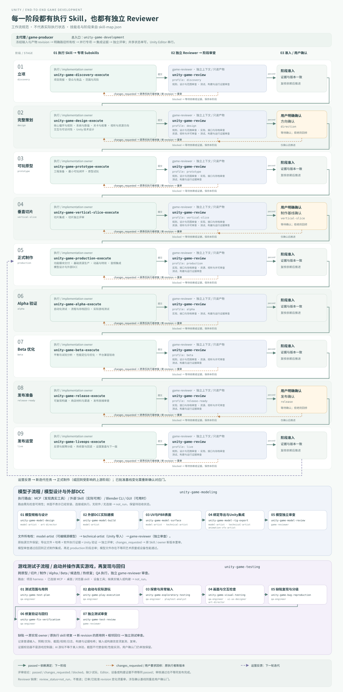

# Unity 游戏全流程 Manifest

从创意到运营的 Unity 2D / 3D 工作流，适用于独立开发者和小团队。提供 21 个按需协作的原生 subagent 角色、67 个层级技能（含阶段执行和独立审查）、九阶段生命周期、项目文档模板，以及 Python 标准库 Unity Editor CLI 辅助工具。

## 安装

```bash
vibe init unity-game ./my-game
vibe add manifest unity-game ./existing-game
# 直接使用本 manifest 的安装脚本
bash manifests/unity-game/scripts/init-unity-game.sh './my game' --dry-run
bash manifests/unity-game/scripts/init-unity-game.sh './my game'
```

安装工作流，不下载 Editor，不自动创建游戏、不更改 Unity 项目设置，也不自动发布。已有文件默认逐文件保留；`--force` 只更新本 manifest 已登记管理的模板文件，并在覆盖前保留备份。安装中断保留事务日志，使用同一版本模板重试可恢复管理归属；若中断后更换模板且移除旧路径，按诊断先恢复原模板再重试。已有的非本模板文件（包括入口文档及同名角色）即使首次使用 `--force` 也保持原样。若根 `CLAUDE.md` / `AGENTS.md` 被保留，请手动把本工作流入口与要求合并进去，并让代理先读取 `.unity-game/README.md`。`.unity-game/state/`、`.unity-game/deliverables/` 与实际游戏资产始终保留。`--dry-run` 仅展示计划，不创建目标目录和文件。通过 `vibe` 安装时，`skills.txt` 的五个顶层技能（游戏专项包和四个通用技能）沿用 CLI 的技能解析与安装机制；直接运行 init 脚本不安装技能。模板 `--force` 刷新保留已有必需技能；安装后检查必需文件与catalog兼容，旧包缺少新技能或支持文件时返回`needs_migration`，先备份定制再合并/更新后重试，不自动覆盖定制；明确要刷新某个技能时使用 `vibe add skill NAME --force`。

## 安装后的布局

```text
CLAUDE.md / AGENTS.md             # 项目工作入口
.claude/agents/*.md               # 21 个 Claude Code subagent
.codex/agents/*.toml              # 21 个 Codex subagent
.unity-game/
  README.md
  agents/subagent-roles.md
  references/                    # 生命周期、编排、Unity 工程规范
  templates/                     # 可复制文档与可选 Editor 构建入口
  scripts/unity_cli.py            # doctor / test / build
  scripts/dcc_cli.py              # 可选 Blender doctor / run
  scripts/game_test_cli.py        # 只读检查游玩记录/证据与独立审查
  state/{status,tasks,decisions,artifacts}.md
  deliverables/                  # 实际项目产物，按需创建
```

模板仓库中的 `references/`、`templates/`、`scripts/` 安装后移入 `.unity-game/`；本文代码路径均从安装后项目根运行。模板文档留在 templates，只将需要的模板复制到 deliverables 后填写。

## 第一次会话

可直接对主代理说：

> 使用 unity-game 工作流开发这个项目。先恢复状态并检查已有工程，确认类型、2D/3D、受众、平台、工期与预算。尽可能将独立工作并行分派给 subagent；先完成立项和设计，等我确认方向再进入原型。

主代理读取根入口与四个状态文件，建立简报。没有游戏想法时先比较少量可实现方案；已有工程则盘点现状和技术债，从首个未满足的阶段验收继续。Unity 版本、管线、平台、包依赖和性能预算在具体项目中选择，不由模板锁定。

## 工作流

| 阶段 | 核心交付 | 主要角色 |
|---|---|---|
| discovery | 简报、市场来源、范围/风险 | producer + market-researcher |
| design | GDD/TDD、系统数值、关卡叙事、视听规范、里程碑 | designers + architect + art/UI/audio |
| prototype | 最小玩法闭环、技术验证、试玩报告 | gameplay + tools + QA + playtest |
| vertical-slice | 代表关卡、最终品质链路、可复现构建 | 工程 + 内容 + 视听 + QA |
| production | 功能/内容批次、资源清单、评审记录 | 按模块并行 |
| alpha | 功能完整、流程/存档验收、缺陷表 | QA + reviewer |
| beta | 平衡、性能、兼容、可访问性/本地化 | playtest + performance + UI |
| release-ready | 候选包、商店材料、许可、更新回退 | release + publishing |
| live | 发布记录、反馈与指标、热修复、复盘 | publishing + producer + QA |

三个用户确认门分别在方向、垂直切片和发布。阶段条件与返工规则见 `.unity-game/references/lifecycle.md`。多人协作不意味着多人同时编辑 Scene：路径单写者、共享状态主代理单写、Editor 操作同工程串行。

## 各环节的 Skills

游戏专项包 `unity-game-development` 包括总入口、9个阶段skill、29个原有专项、模型链6个、实际游戏测试8个、9个执行skill及reviewer的5个技能，共67个真实 `SKILL.md`。例如 design 下分核心循环、数值、关卡叙事、视听方向、UI/UX 与技术设计；production 下分功能、基础资源、动画/VFX 与音频。每个专项包含具体输入、工作方法、产物和验收，并映射到负责的 subagent。

完整阶段表和安装/升级说明见 `.unity-game/references/skills.md`；机器可读目录位于 `.agents/skills/unity-game-development/references/skill-map.json`。整包只在 `skills.txt` 声明一次，安装时递归带上全部子技能；也可按真实名称单独安装阶段或专项：

```bash
vibe add skill unity-game-development ./my-game
vibe add skill unity-game-design ./my-game
vibe add skill unity-game-performance ./my-game
```

对已装模板使用 `vibe add manifest unity-game ./my-game --force` 刷新角色路由并补装缺少的包；已存在的包保持原样，需要更新时明确运行 `vibe add skill unity-game-development ./my-game --force`（先保留自定义修改）。独立使用子技能时沿用当前工程与工具，不要求先安装整个 manifest。

## 模型设计与外部软件

模型链为 **规格设计 → 实际DCC建模 → UV/PBR → 可选绑定/导出 → Unity接力 → 独立模型审查**，由model-artist、technical-artist和独立game-reviewer分别认领。`unity-game-modeling` 含5个subskills，可整组或单项安装。

[接入说明与可选MCP配置](references/external-tools.md) 支持已连接Blender/Unity MCP、已有软件skill，以及Blender CLI/Python；Maya/Max等沿用实际接口或外部skill。模板安装只分发示例，不自动安装软件、启动服务或改写宿主配置。

```bash
# 只安装模型skill时不会附带manifest helper；以下Python命令需先完成manifest安装
vibe add skill unity-game-modeling ./my-game
cd ./my-game
python3 .unity-game/scripts/dcc_cli.py doctor --blender /path/to/blender --output-dir Evidence/doctor-001
# 已有模型导出：源文件保留，在新目录运行副本
python3 .unity-game/scripts/dcc_cli.py run --blender /path/to/blender --project Art/source.blend --script .unity-game/templates/Blender/export_model.py --output-dir Evidence/model-export-001
# 新模型：必须提供按简报编写的建模脚本，导出模板不是模型生成器
python3 .unity-game/scripts/dcc_cli.py run --blender /path/to/blender --new --script Art/create_model.py --output-dir Evidence/model-create-001
```

输出核验只是本地文件契约，不等于美术或Unity验收；缺软件/连接时相关项not_run。

## 测试游戏：启动、操作、发现与复测

新增 **`unity-game-testing`**，下分7个独立subskills：`unity-game-test-plan`、`unity-game-play-execution`、`unity-game-exploratory-testing`、`unity-game-visual-testing`、`unity-game-bug-reproduction`、`unity-game-fix-verification`、`unity-game-test-review`。它跨原型、切片、制作、Alpha/Beta、发布和热修复使用。

不是只写测试计划：先检查真实构建/窗口、输入通道和隔离数据，再通过普通输入实际游玩、截图/日志观察、异常探索、最短复现；原实现owner修复后，QA重跑原用例及相邻回归，最后独立reviewer审查。AI操作不等于真人乐趣反馈；EditMode/PlayMode、音频/性能和设备测试各自保留证据。

```bash
# 只安装测试技能链，或安装单项；完整manifest已包含整条链
vibe add skill unity-game-testing ./my-game
vibe add skill unity-game-play-execution ./my-game
# 以下helper需已安装manifest，并在项目根运行；它检查记录，不操作游戏
python3 .unity-game/scripts/game_test_cli.py check --session Evidence/run-001/session.json --review Evidence/run-001/review.json --require-review
```

可直接要求代理：**“使用unity-game-testing测试这个构建，先确认实际输入能力，完成首局/暂停重试/存读档，记录可复现bug，修复交原owner，再独立复验。”** 没有构建、窗口或工具时对应项not_run，不用看代码或注入状态冒充游玩。协议、模板与执行通道见 [实际游戏测试说明](references/game-testing.md)。

## 执行 Skill、Reviewer 与 Workflow

每个阶段由对应 `*-execute` skill 执行，实际交付后交独立 `game-reviewer` 使用 `unity-game-review`/阶段profile。Reviewer 分设计、代码、资产、证据四类子技能。通过并满足用户门后推进；修改退回原skill/owner；缺证据或缺独立审查则等待。审查绑定revision/哈希，更新输入重新审查。

[打开完整 workflow SVG](references/workflow.svg)（可缩放）：



```bash
# 源仓库：从真实技能映射再生成图；--check仅检查一致性
python3 manifests/unity-game/scripts/render_workflow.py --check
# 项目安装后
python3 .unity-game/scripts/render_workflow.py
```

图是流程规范，不表示游戏已实现、测试通过或已发布。

## Unity 命令

```bash
python3 .unity-game/scripts/unity_cli.py doctor --project .
python3 .unity-game/scripts/unity_cli.py test --project . --mode editmode --editor /path/to/Unity
python3 .unity-game/scripts/unity_cli.py test --project . --mode playmode --editor /path/to/Unity
python3 .unity-game/scripts/unity_cli.py build --project . --target StandaloneLinux64 --execute-method UnityGameBuild.Build --output ./Builds/Linux/Game --editor /path/to/Unity
```

`--help` 展示全部选项。`UnityGameBuild.Build` 是示例，必须由项目提供；可选入口模板在 `.unity-game/templates/Editor/`，不会自动加入 Assets。Editor 路径优先取 `--editor`，再取 `UNITY_EDITOR`，最后按项目版本查找常见安装目录；多候选需要显式指定。没有 Editor 仍可准备文档和做静态审查，测试/构建记录保留 `not_run`。

每次运行在 `.unity-game/runs/<run-id>/` 保存 `result.json`、`stdout.txt`、`stderr.txt`、`editor.log`，实际测试另有 `results.xml`；预检失败时结果文件说明未运行的原因。辅助工具进程退出码为 `0`（passed）、`1`（failed）、`2`（not_run），`result.json` 另保留实际 Editor 退出码。`doctor` 通过只表示环境预检通过，不代表已测试游戏。构建输出相对 `--project` 解析，每次选用尚不存在的新路径，已有输出始终保留。运行记录包含原样命令、退出码、日志与结果位置。零测试、超时、缺结果或缺构建产物不标记成功。测试/构建证据绑定Assets/Packages/ProjectSettings输入快照与输出哈希；运行期间输入变化使结果失效。构建按平台结构核验，可选C#入口另写BuildReport侧车；结构通过不等于Player已启动。真实 Editor / 目标设备验收与伪 Editor 的辅助工具回归测试分开记录。

## 模板清单

`project-brief`、`gdd`、`tdd`、`systems-balance`、`level-narrative`、`asset-spec`、`milestones`、`task-package`、`handoff`、`review`、`test-plan`、`playtest-report`、`performance-report`、`release-checklist`、`operations-retrospective`、`model-brief`、`model-delivery`、`external-tool-session`、`game-test-session.md/json`、`game-test-review.json`、`bug-report`。共享状态种子位于 `templates/state/`，只在首次缺失时安装。

通用技能为 `version-management`、`git-manager`、`omnidraw`、`state-machine-reasoning`；Unity 专项方法由 `unity-game-development` 层级技能包提供，流程与角色由本 manifest 编排。角色全集与任务输入/输出见 `.unity-game/agents/subagent-roles.md`。
