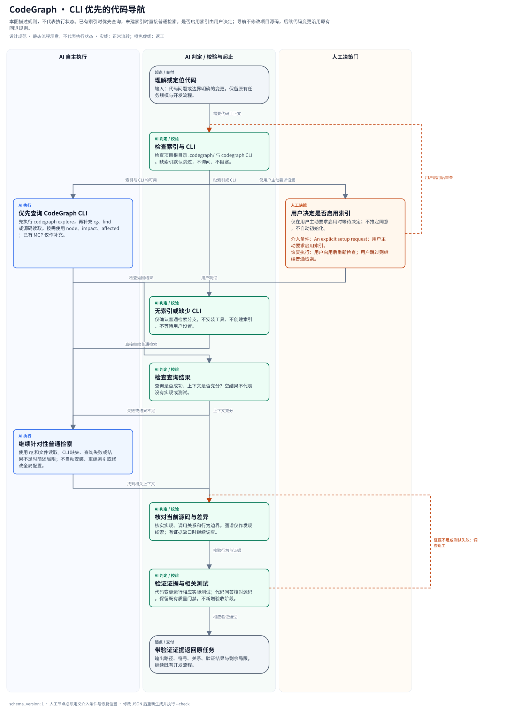

# Vibe Coding Unified Manifest

Full lifecycle engineering manifest covering 0-to-1 project building → development → testing → CI/CD → production deployment across 5 languages and 5 cloud platforms.

## What's Included

- **MANIFEST.md**: Canonical AI instructions; `AGENTS.md` and `CLAUDE.md` are symlinks to it in the manifest and initialized projects.
- **15 Scenarios**: agent-dev, api-service, cli-tool, cross-platform, data-pipeline, distributed, frontend, fullstack-web, llm-dev, research, saas, desktop-electron, desktop-tauri, desktop-flutter, wechat-miniprogram.
- **17 Rules**: Core, standards, collaboration, lifecycle, deployment, backend, frontend, testing, refactoring, optimization, UI design, cloud, enterprise, agent-dev, desktop, frontend-scenario, CLAUDE.md maintenance.
- **15 Commands**: plan, scaffold, implement, quality-gate, deploy-check, lang-select, cloud-deploy, release, agent-eval, frontend-check, desktop-build, update-docker, update-docs, update-examples, update-scripts.
- **5 Cloud Platform References**: Vercel, Cloudflare, Tencent Cloud, Alibaba Cloud, Huawei Cloud.
- **5 Language Specs + Decision Trees**: Go, Rust, Python, TypeScript/JavaScript, Java.
- **Code hosting and CI/CD**: Git-only, GitHub (12 workflows and governance), GitLab CI, or Gitee Go; shared VERSION/Changelog checks and tag releases.
- **Enterprise References**: Branching strategy, release process, PR conventions, tag conventions.
- **39 Skills installed by the vibe CLI**: Four manifest-bundled skills, Anthropic's `canvas-design` (installed as `anthropics-skills-canvas-design` to disambiguate sources), three `wxa-skills-*` skills, and all 31 published Matt Pocock Chinese skills.
- **Templates**: CHANGELOG, README, release checklist, roadmap.

## Quick Start

### Initialize a New Project

```bash
bash manifests/vibe-coding/scripts/vibe-init.sh \
  --scenario=fullstack-web \
  --cloud=vercel \
  --org mycompany \
  --repo my-app \
  --provider=github

# Or via the vibe CLI; use `vibe add manifest` for an existing project.
vibe init vibe-coding ./my-app --provider=gitlab
vibe add manifest vibe-coding ./my-app --provider=gitee --dry-run
```

### Required Skills and First-Time Setup

`vibe init vibe-coding` and `vibe add manifest vibe-coding` install the dependencies
in `skills.txt` into the target project's `.agents/skills/`. Running
`scripts/vibe-init.sh` directly installs the scaffold only, not these dependencies;
use the vibe CLI to install the complete manifest.

The [Matt Pocock Chinese skill bundle](https://github.com/vinvcn/mattpocock-skills-zh-CN)
is tracked as the managed `skills/mattpocock-skills-zh-CN` submodule on `main` and
participates in `vibe update`. The manifest includes the published `engineering`,
`productivity`, and `misc` buckets only. Translation maintenance (`.skills`), beta
(`in-progress`), and retired/out-of-scope skills are not default dependencies.
New upstream skills must be explicitly added to `skills.txt` when updating the bundle.

After installation, run `/setup-matt-pocock-skills` in your coding agent once per
project, before using the engineering skills. It guides you through issue tracker,
triage labels, and domain documentation configuration. Initialization copies the
skills only; it does not run setup or choose those settings for you.

### Optional CodeGraph Navigation

[CodeGraph](https://github.com/colbymchenry/codegraph) gives coding agents indexed symbol source and call relationships. The manifest uses its CLI first when the project root already contains `.codegraph/`: start with `codegraph explore "<question, symbol, or file>"` before broad search or code reads. `node`, `impact`, and `affected` help with targeted reading, change-impact analysis, and candidate test discovery; see the [canonical instructions](MANIFEST.md#code-navigation-cli-first-codegraph) for examples.

CodeGraph is optional, not a new required Skill or quality gate. With no index, use ordinary search immediately; do not pause the task to request indexing. A missing CLI, failed query, or insufficient result falls back to focused `rg` and file reads with a brief limitation note. Verify source and run actual tests regardless of graph coverage. An already configured MCP tool may supplement the CLI; initialization does not install CodeGraph, wire up MCP, or modify global agent settings.

Indexing is the user's decision. If you choose to enable it, follow the [official installation instructions](https://github.com/colbymchenry/codegraph#get-started), then run this yourself in the intended project:

```bash
codegraph init
```

Neither `vibe init/add/update` nor the agent's normal code-navigation flow runs that command or rebuilds an index automatically. Existing CodeGraph indexes and configuration are left untouched by manifest installation and updates. CLI examples were checked against v1.6.2; the manifest does not pin or upgrade the installed tool.



[Editable JSON](references/codegraph-workflow.json) · [Standalone renderer](scripts/render_codegraph_workflow.py). This diagram documents navigation rules, not task progress; the optional setup branch is entered only on an explicit user request. Source inspection and actual tests remain AI validation responsibilities. See [MANIFEST.md](MANIFEST.md#code-navigation-cli-first-codegraph) for the boundaries and fallback behavior.

From this manifest directory or an initialized project root, use Python's standard library to regenerate or run the read-only drift check:

```bash
python3 scripts/render_codegraph_workflow.py --source references/codegraph-workflow.json --output references/codegraph-workflow.svg
python3 scripts/render_codegraph_workflow.py --source references/codegraph-workflow.json --output references/codegraph-workflow.svg --check
```

The installer distributes exactly these three workflow assets at the same relative paths; updates include them in the existing backup/restore transaction while preserving the project's README and data.

### Available Init Flags

```
--scenario=<name>[,<name>...]   15 scenarios (agent-dev, api-service, cli-tool, cross-platform,
                                  data-pipeline, distributed, frontend, fullstack-web,
                                  llm-dev, research, saas,
                                  desktop-electron, desktop-tauri, desktop-flutter,
                                  wechat-miniprogram)
--cloud=<provider>              vercel / cloudflare / tencent / alibaba / huawei
-o, --owner <owner>             CODEOWNERS default owner
--org <org>                     GitHub organization
--repo <repo>                   GitHub repository
--email <email>                 Security contact email
--provider=<name>             git / github / gitlab / gitee (default: github)
--git / --no-git                Git initialization (default: auto)
-f, --force                     Overwrite existing files
-n, --dry-run                   Preview without writing
```

### Scenarios Summary

| Scenario | Focus | Languages |
|----------|-------|-----------|
| `agent-dev` | AI agent systems | Python, TypeScript |
| `api-service` | REST/gRPC backend | Go, TypeScript, Java |
| `cli-tool` | CLI utilities | Go, Rust, TypeScript |
| `cross-platform` | Multi-platform apps | TypeScript, Rust |
| `data-pipeline` | ETL and data processing | Python, Go |
| `distributed` | Distributed systems | Go, Rust |
| `fullstack-web` | Full-stack web apps | TypeScript + Go |
| `llm-dev` | LLM applications | Python, TypeScript |
| `research` | Research/experimentation | Python |
| `saas` | SaaS products | TypeScript + Go/Python |
| `frontend` | Pure frontend apps | TypeScript |
| `desktop-electron` | Electron desktop | TypeScript + Node.js |
| `desktop-tauri` | Tauri desktop | TypeScript + Rust |
| `desktop-flutter` | Flutter desktop | Dart |
| `wechat-miniprogram` | WeChat Mini Program and AI mode skills | TypeScript/JavaScript, WXML, WXSS |

## Language Support

| Language | Reviewer | Build Resolver | Patterns | Testing |
|----------|----------|----------------|----------|---------|
| Go | go-reviewer | go-build-resolver | golang-patterns | golang-testing |
| Rust | rust-reviewer | rust-build-resolver | rust-patterns | rust-testing |
| Python | python-reviewer | — | python-patterns | python-testing |
| TypeScript | typescript-reviewer | build-error-resolver | frontend-patterns | e2e-testing |
| Java | java-reviewer | java-build-resolver | java-coding-standards | springboot-tdd |
| Kotlin | kotlin-reviewer | kotlin-build-resolver | kotlin-patterns | kotlin-testing |
| C++ | cpp-reviewer | cpp-build-resolver | cpp-coding-standards | cpp-testing |
| C# | csharp-reviewer | — | dotnet-patterns | csharp-testing |
| Dart/Flutter | flutter-reviewer | dart-build-resolver | dart-flutter-patterns | flutter-test |

## Cloud Platforms

| Platform | Deploy Command | Reference |
|----------|---------------|-----------|
| Vercel | `vercel deploy --prod` | `references/cloud-platforms/vercel.md` |
| Cloudflare | `wrangler deploy` | `references/cloud-platforms/cloudflare.md` |
| Tencent Cloud | `serverless deploy` | `references/cloud-platforms/tencent-cloud.md` |
| Alibaba Cloud | `fun deploy` | `references/cloud-platforms/alibaba-cloud.md` |
| Huawei Cloud | `fgs deploy` | `references/cloud-platforms/huawei-cloud.md` |

## Desktop Frameworks

| Framework | Best For | Reference |
|-----------|----------|-----------|
| Electron | Full Node.js + Chromium access, mature ecosystem | `scenarios/desktop-electron/` |
| Tauri | Minimal binary, Rust backend, best security | `scenarios/desktop-tauri/` |
| Flutter Desktop | Shared mobile+desktop codebase | `scenarios/desktop-flutter/` |

See `references/desktop-frameworks.md` for full comparison and decision guide.

## Version records and CI/CD

Initialization creates root `VERSION` and `CHANGELOG.md` (unless already present). Every version bump must add a meaningful section to Changelog in the same change. Run `python3 scripts/version_guard.py check --base-ref origin/main` before merging; tag releases run `check --tag vX.Y.Z` and publish only that section. Optional POSIX hooks are `scripts/ci.sh` and `scripts/build.sh`; `dist/` files are attached when present. Set `--provider=git` for local-only workflow, or select GitHub, GitLab, or Gitee. For GitLab enable runners; for Gitee enable Gitee Go and configure `GITEE_OWNER`, `GITEE_REPO`, and secret `GITEE_TOKEN`. See `references/release-process.md`.

## Dependencies

- **Bash**: Init and maintenance scripts.
- **Git**: Version control.
- **GitHub CLI** (`gh`): Optional for GitHub repository operations and CI monitoring.
- **Language toolchains**: Go, Rust, Python (uv), Node (pnpm), Java (maven/gradle) as needed.
- **Cloud CLIs**: Platform-specific CLIs for cloud deployments.

## File Count

~150 files total covering the complete engineering lifecycle from idea to production.
