# Office Quality

本技能负责办公文件的编排与验收，不重新实现格式引擎。先定位当前环境实际可用的文档 skill；精确来源为 `anthropics/skills/docx`、`anthropics/skills/xlsx`、`anthropics/skills/pptx`、`anthropics/skills/pdf`。Office manifest 安装时目录为 `.agents/skills/anthropics-skills-<format>/`；单独安装本技能时按环境发现 skill，不依赖仓库或个人目录。辅助脚本只在 Office manifest 已安装时可用，缺脚本则用可用引擎执行同等检查并记录命令。

## 工作契约

- 图片/配图/示意图/数据绘图先用 `omnidraw`，所有表格/表格数据模型/布局与工作簿先用 `omnisheet`，再进入底层文档 skill。Office 安装入口为 `.agents/skills/omnidraw/SKILL.md` 和 `.agents/skills/omnisheet/SKILL.md`；单独安装本技能时按当前环境发现。matplotlib 绘图也从 Omnidraw 进入，最终原生表格/图表与文件仍由格式工程师写入，不把表格转图、不额外创建未请求工作簿。

- 确认受众、用途、模板、输入来源、格式、文风参考、图文计划、需保留特性和验收条件。文风任务主动抽取样本模式与例证并由写作/审阅对照；正文主张映射到真实图表/素材来源、可编辑源、题注/替代文本及交叉引用，无视觉必要时不强制装饰。简单任务轻量处理；复杂或跨格式任务持久化计划，共用一份已核对的数据。
- 编辑基于副本，先记录源哈希。默认保留原件和原生可编辑内容；仅按用户要求覆盖并保留备份。不顺带改全局配置、创建分支或提交。
- PPT 新建/编辑先用 `omnippt`，按需从受众/目标与来源到可移动大纲、朴素分镜、视觉 tokens、原生构建和独立审阅；小改复用有效上下文，不强制六阶段或外部研究。图片仍由 Omnidraw、表格/数据由 Omnisheet 路由，office-pptx 独占最终演示。新增数据图表/宏分别确认并验收实际原生/保留/执行能力，详读 PPTX 清单；SVG 嵌入不是逐元素可编辑证明。
- Excel 的新增图表和宏使用分别主动确认 yes/no/pending，复用已明确答复；未答继续非图表/非宏工作，既有图表/宏默认保留而非新增/执行许可。宏源码、包保留与实际 Excel 执行分别验收，详读 XLSX 清单。
- Word 公式保留 LaTeX/Markdown 源，交付可编辑 OMML；图/表/公式动态编号与交叉引用按 DOCX 清单验收实际域更新，不静默栅格化或硬填显示号，第三方文献域沿用原管理器。
- 按实际应用能力选引擎；原生样式/主题、编号、字段、控件、修订、图表/OLE/SmartArt、宏按需使用，不把库接口缺口变成全局禁令。适用要求映射为原生对象/属性并审计；锁定/限制编辑只按用户范围启用，宏存在不表示自动执行。
- 每个文件一个写入者。格式引擎完成制作后，依次取得重新打开/结构、内容与业务值、适用的重算、全量视觉审阅证据，再派发独立 `office-qa`；审查者不兼任该文件制作人，也不在 QA 时直接修文档。
- QA 问题交回制作人修复；最终文件改变后更新哈希并重做相关检查/渲染，再独立复验。只有当前最终版本的证据有效。
- DOCX/PPTX/PDF 看全部页面；XLSX 查全部工作表的数据与公式，视觉覆盖全部声明为交付视图的打印区域。只读提取免独立 QA，但给出来源定位和 OCR/提取限制。

## 按需加载

只读本次格式的清单：[DOCX](references/docx.md)、[XLSX / CSV](references/xlsx.md)、[PPTX](references/pptx.md)、[PDF](references/pdf.md)。准备角色交接或最终交付时读 [交接、证据与报告模板](references/delivery.md)。

状态为 `draft`（制作中）、`pending`（检查未完成/有问题）、`passed`（全部适用门禁及独立 QA 有实际证据）。依赖缺失、缓存未经验证、未审阅预览或缺独立代理时标记 `pending`，列出下一验收动作。结构脚本退出 0、生成 PDF/PNG、口头“看起来没问题”均不是质量通过的替代证据。
