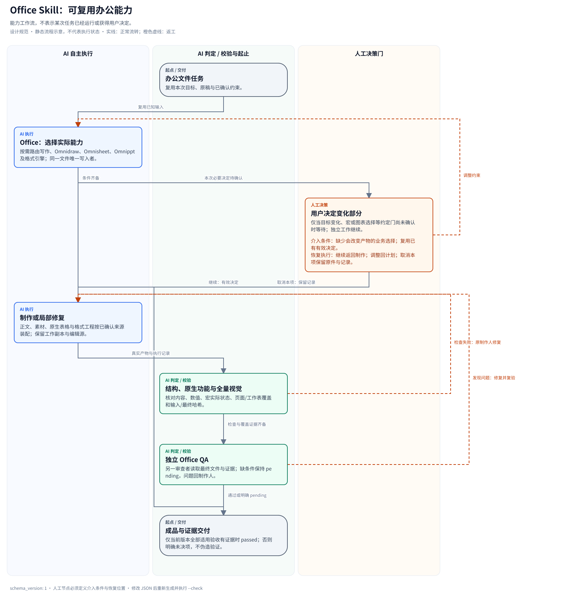

# Office

办公文件的可复用能力入口。按实际任务选择写作、图表与格式引擎，保留原件、原生可编辑内容和真实验收证据；无需先安装某个 Manifest。



## 开始与路径

本技能根目录是包含当前 `SKILL.md` 的目录，记作 `OFFICE_SKILL_ROOT`。先读 [质量规则](rules/quality.md)、[文件保护](rules/file-safety.md)，再只读本次格式指南。正文/数据/产物与记录留在用户项目，不写回技能目录。

指南里的 `.agents/skills/office/…` 是 vibe 默认安装布局示例；技能位于其他目录时按实际根目录替换。不要依赖源码仓库的 `manifests/office`、项目根 `office/` 或创作者机器路径。其他技能同样通过宿主发现实际入口，默认安装名不是路径存在的证明。

## 按任务路由

| 任务 | 本包指南 | 配套能力（实际存在时按需加载） |
| --- | --- | --- |
| 正文起草、润色与参考样本文风 | [图文与文风交接](docx/references/voice-and-visuals.md) | `z-writing`；仅纠错不扩大为重写 |
| 图片、示意图和数据绘图 | [素材交接](agents/subagent-roles.md) | `omnidraw`，使用随包 UI 约束及真实来源 |
| 表格数据、模型和布局 | [XLSX 指南](xlsx/CLAUDE.md) | `omnisheet`，原生表格仍交最终格式工程师插入 |
| Word 文件工程 | [DOCX 指南](docx/CLAUDE.md)、[规则](rules/docx.md) | 精确来源 `anthropics/skills/docx` |
| 工作簿 | [XLSX 指南](xlsx/CLAUDE.md)、[规则](rules/xlsx.md) | 精确来源 `anthropics/skills/xlsx` |
| 演示文稿 | [PPTX 指南](pptx/CLAUDE.md)、[规则](rules/pptx.md) | `omnippt` → `anthropics/skills/pptx` |
| PDF 操作 | [PDF 指南](pdf/CLAUDE.md)、[规则](rules/pdf.md) | 精确来源 `anthropics/skills/pdf` |
| 复杂或跨格式任务 | [规划指南](planning/CLAUDE.md) | 复用已确认目标、材料、来源与口径 |
| 最终验收 | [质量规则](rules/quality.md)、[角色与交接](agents/subagent-roles.md) | `office-quality` 与当前格式能力 |

配套技能缺失时只检查本次所选能力，并明确相应未决项；不启动无关外部服务、不安装全套系统依赖。本包提供通用指南与工具，格式引擎是可组合依赖，不把第三方 Skill 复制进本包。

## 制作、检查与交付

- 编辑前记录源 SHA-256，使用工作副本；同一最终文件只有一个写入者。保留未选内容、模板、样式、公式、批注、修订、关系和宏。
- 样文、正文主张、来源/数据、图表类型、编辑源、题注、替代文本和交叉引用共同规划；已知输入直接沿用，无信息价值时不加装饰。
- Word 公式交付可编辑 OMML，动态编号/引用实际更新后核验；[公式与域](docx/references/equations-and-fields.md) 和 [原生排版/宏](docx/references/native-formatting.md) 按需加载。
- 宏源码、项目保留与实际应用编译/执行分别验收。宏或新增图表的决定沿用已有明确范围；未决时继续独立工作，不把文件存在当成运行成功。详见 [Excel](xlsx/references/charts-and-macros.md) 与 [PPTX](pptx/CLAUDE.md)。
- 重新打开最终文件，核对内容、数据与原生特性，再实际查看全部页面；XLSX 核对全部表的数据/公式和约定打印视图。修订后更新哈希、检查和预览。
- 创建/修改交付文件后取得独立 QA；可用角色源为 [Claude](agents/claude/) / [Codex](agents/codex/)，只选择本次角色。独立上下文不可用时记录该门 pending，不把制作人自检冒充独立 QA。只读提取使用轻量来源核对。
- 输出 `draft` / `pending` / `passed`、路径/哈希、实际命令与退出状态、检查与覆盖证据和剩余项。只依据当前最终版本；项目已有 `MANIFEST.md` 时追加登记，不另造重复账本。

## 随包工具

先将环境变量 `OFFICE_SKILL_ROOT` 指向实际发现的技能根目录，然后按需运行：

```bash
python "$OFFICE_SKILL_ROOT/scripts/doctor.py"
python "$OFFICE_SKILL_ROOT/scripts/verify.py" FILE --output REPORT.json
python "$OFFICE_SKILL_ROOT/scripts/render.py" FILE --out-dir PREVIEWS
```

Word 原生检查/排版工具位于 `docx/scripts/`，VBA 源位于 `docx/macros/`；Excel 分析/重算及宏保留工具位于 `xlsx/scripts/`，VBA 源位于 `xlsx/macros/`。工具覆盖范围和所选应用执行状态分别报告；不降低全局信任设置或自动运行未知输入宏。

## 安装与项目边界

`vibe add skill office <target>` 只安装本技能，不生成项目根指令、不注册宿主角色、不自动安装其他 Skills。已有文档、科研、基金等项目可以按需复用本能力。完整办公工作区使用 `vibe init office <target>`：业务 Manifest 负责项目简报、来源/版本、交付决策和归档，并显式安装本技能及配套 Skills。

[工作流源](assets/workflow.json)；从本技能根目录再生成及只读检查：

```bash
python scripts/render_workflow.py --source assets/workflow.json --output assets/workflow.svg
python scripts/render_workflow.py --source assets/workflow.json --output assets/workflow.svg --check
```
