# Omnidraw

Routes drawing requests to the right sub-skill based on **what you need** and **what scenario you're in**.

[可编辑 Mermaid 图源](assets/workflow.mmd)。流程图展示本技能的路由与审阅闭环。

## 安装后的路由与办公配图

- 先读本技能内所选子目录的 `SKILL.md`；例如 `mermaid/` 的语法与模板可独立使用。仅检查本次路线需要的工具，不要求初始化全部上游子模块。
- 文中 `../../skills/...` 链接是**源码仓库内的可选上游参考**。安装到项目后，先按技能名发现当前可用的已安装 skill（如 `ccf-visual-composer`），再读取其真实路径；不沿用失效的仓库相对路径，不把缺少可选上游当成全部绘图路线不可用。
- 办公配图统一从 Omnidraw 分流：流程/逻辑说明优先本地 Mermaid，精确布局使用当前可用的可编辑矢量路线；插画/照片选可用图像工具；真实数据图选 matplotlib。文字、单位、来源、图意和视觉一致性均需审阅，问题回到制作路线修复。
- 保留可编辑图源、预览、题注/替代文本和来源；文档角色负责嵌入原生办公文件。表格内容、合计与单位交给当前可用的 `omnisheet` 技能，避免把可编辑表格当成配图截图。

## Sub-Skills

| Sub-Skill | Best For | Deps |
|-----------|----------|------|
| [mermaid](mermaid/SKILL.md) | Sequence, ERD, Gantt, git, mindmap, state, quick markdown | 本地语法可直接使用；渲染器按环境选择，上游 Pretty-mermaid-skills 可选 |
| [gpt-image-2](gpt-image-2/SKILL.md) | Illustrations, concept art, logos, photos (OpenAI) | `OPENAI_API_KEY` |
| [nano-banana](nano-banana/SKILL.md) | Photos, concept art, fast iteration (fal-ai v1/v2) | fal-ai MCP |
| [plantuml](plantuml/SKILL.md) | UML (class, use case, activity, component, deployment) | None |
| [matplotlib](matplotlib/SKILL.md) | Data charts, publication figures, statistical plots | Python |
| [canvas-design](canvas-design/SKILL.md) | Posters, design artifacts | canvas-design skill |
| [scientific-schematics](scientific-schematics/SKILL.md) | Publication schematics, mechanism diagrams | scientific MCP |
| [ccf-visual-composer](../../skills/CCFA-Skills/ccf-visual-composer/SKILL.md) | CCF-A paper figures, visual tables, method/architecture diagrams, and editable reconstruction | CCFA-Skills; GPT Image 2 by default, pure SVG on request |
| Happy Figure + figure2pptx | Research workflows, mechanisms, graphical abstracts, structured prompts, editable PPTX delivery | Install/load the corresponding skills in the environment |

**Unsupported:** Draw.io and Excalidraw are not Omnidraw generation or routing targets. Do not dispatch tasks to them. For scientific figures, classify the figure first and route via Happy Figure principles; use Mermaid/PlantUML for text-native diagrams, Matplotlib for data, and image-generation plus figure2pptx reconstruction for explanatory illustrations where appropriate.

## 科研主图参考图

当任务是 CS/ML 论文的 Figure 1、teaser、方法总览或图形摘要时，先判定图型（`framework`、`pipeline`、`architecture`、`conceptual`、`teaser`、`taxonomy`），再按相同图型检索 [Top-Conf Figure Gallery 在线画廊](https://qwdwqfwq.github.io/topconf-paper-figure-gallery/)；[仓库与数据说明](https://github.com/qwdwqfwq/topconf-paper-figure-gallery)。它是**版式参考库**，不是科学内容来源或默认绘图引擎。

从参考图仅提炼布局、元素组织、配色和视觉层级，形成可核对的视觉契约；科学对象、箭头关系、标签和数值必须来自当前论文材料。然后用 Happy Figure 按领域 × 图型 × 目标模型编译绘图 prompt，需要可编辑 PPTX 时再交给 figure2pptx 重建。避免跨图型混用参考图，也不要照搬单张参考图的内容或构图。

**科研主图文字规则：**先列出图内实际需要的短标签白名单，生成提示词时明确要求只呈现这些标签。不要用小号灰字、灰色横线、模糊段落或伪文字来填充文档卡片、输入框、输出框；无文字内容的区域保留留白或使用有语义的图形符号。出图后逐区检查，若出现上述占位文字，清除并重新生成或在可编辑重建阶段删除，不能作为最终图交付。

## 数据统计图参考与复现

数据驱动的统计图、复合多面板图，优先使用可执行绘图代码，而不是图像生成模型。参考 [NaturePanelForge 仓库](https://github.com/littlepeachs/NaturePanelForge)、[Gallery 画廊](https://uu543493-83c1-74a94416.nma1.seetacloud.com:8448/) 和 [项目主页](https://littlepeachs.github.io/NaturePanelForge/)；其 `codex-panel-reproduce` 路线适合将**已有目标 panel 图像**重建为可编辑的 Python/Matplotlib 代码，并通过渲染、对照审查和迭代改进结果。

先区分两种任务：**复现已有 panel** → 参考 NaturePanelForge 的 panel-to-code 流程；**用用户数据制作新图** → 参考同类图的布局、编码与排版，用 [matplotlib](matplotlib/SKILL.md) 从实际数据绘制。多面板图先分解图型、坐标、图例、单位和面板关系，再分别生成并组合；不得从参考图推测或填造原始数据、误差线或显著性结果。

## Scenario Dispatch

### 专利附图
→ 结构/流程图按科学图型选择 Mermaid/PlantUML 或 Happy Figure + figure2pptx；数据图用 [matplotlib](matplotlib/SKILL.md)

### 学术论文图 — English (IEEE/ACM/Elsevier/Springer)
→ [mermaid](mermaid/SKILL.md) (序列图)
→ [matplotlib](matplotlib/SKILL.md) (数据图, 300 DPI, serif)
→ [scientific-schematics](scientific-schematics/SKILL.md) (机制图)
→ Happy Figure + figure2pptx (方法/架构/机制/图形摘要；先识别图型，再编译 prompt 并重建可编辑稿)
→ [ccf-visual-composer](../../skills/CCFA-Skills/ccf-visual-composer/SKILL.md) (方法架构、流程、图形摘要、视觉表格；可编辑 SVG/PDF/PPTX)

### 学术论文图 — 中文 (中国科学/计算机学报/软件学报)
→ [matplotlib](matplotlib/SKILL.md) (数据图, 中文标签)
→ [ccf-visual-composer](../../skills/CCFA-Skills/ccf-visual-composer/SKILL.md) (中文/中英方法图、科研示意图与图形摘要)

### 技术架构图
→ [mermaid](mermaid/SKILL.md) (C4, 快速上下文图)

### 流程/逻辑图
→ [mermaid](mermaid/SKILL.md) (快速内联)

### 数据图表
→ NaturePanelForge（已有 panel 的代码复现与审查）；[matplotlib](matplotlib/SKILL.md)（以实际数据绘制新图，发表级）
→ [mermaid](mermaid/SKILL.md) (快速饼图/柱状图)

### 演示文稿 / Pitch Deck
→ [nano-banana](nano-banana/SKILL.md) (v2, 16:9 hero images)
→ [gpt-image-2](gpt-image-2/SKILL.md) (概念插图)
→ Happy Figure + figure2pptx (科研架构图；先判图型，再生成并重建)
→ [matplotlib](matplotlib/SKILL.md) (数据 chart slides)

### 照片 / 真实感图像
→ [nano-banana](nano-banana/SKILL.md) (v2, best quality)
→ [gpt-image-2](gpt-image-2/SKILL.md) (detailed prompt following)

### 概念艺术 / 插画
→ [gpt-image-2](gpt-image-2/SKILL.md) (详细提示词跟随)
→ [nano-banana](nano-banana/SKILL.md) (v2, 快速视觉探索)

### UML 建模
→ [plantuml](plantuml/SKILL.md) (类图/用例/组件/部署)
→ [mermaid](mermaid/SKILL.md) (序列/状态)

### 可编辑交付
→ figure2pptx（将科研图重建为可编辑 PPTX）

### 手绘 / 白板风格
→ [canvas-design](canvas-design/SKILL.md) (设计稿) 或 image-generation 草图路线

### 海报 / 设计产物
→ [canvas-design](canvas-design/SKILL.md) (design-focused)
→ [gpt-image-2](gpt-image-2/SKILL.md) (视觉概念生成)

### 科研示意图
→ [scientific-schematics](scientific-schematics/SKILL.md) (发表级)
→ [ccf-visual-composer](../../skills/CCFA-Skills/ccf-visual-composer/SKILL.md) (视觉契约、审美稿、渲染质检与可编辑重建)

### 快速内联 (Markdown)
→ [mermaid](mermaid/SKILL.md) (零设置, GitHub/Notion/Obsidian 原生渲染)

## Routing Matrix

### Diagrams

| Intent | Primary | Fallback |
|--------|---------|----------|
| Flowchart / process | [mermaid](mermaid/SKILL.md) | [plantuml](plantuml/SKILL.md) |
| System architecture | Happy Figure + figure2pptx (scientific) | [mermaid](mermaid/SKILL.md) (C4) |
| Network topology | Mermaid / PlantUML | — |
| Cloud (AWS/GCP/Azure) | Mermaid / PlantUML | — |
| Sequence diagram | [mermaid](mermaid/SKILL.md) | [plantuml](plantuml/SKILL.md) |
| UML class / use case | [plantuml](plantuml/SKILL.md) | [mermaid](mermaid/SKILL.md) |
| UML activity / component / deployment | [plantuml](plantuml/SKILL.md) | [mermaid](mermaid/SKILL.md) |
| State machine | [mermaid](mermaid/SKILL.md) | [plantuml](plantuml/SKILL.md) |
| ER diagram | [mermaid](mermaid/SKILL.md) (ERD) | [mermaid](mermaid/SKILL.md) |
| Gantt / timeline | [mermaid](mermaid/SKILL.md) | [mermaid](mermaid/SKILL.md) |
| Pie / simple chart | [mermaid](mermaid/SKILL.md) | [matplotlib](matplotlib/SKILL.md) |
| Bar / line / scatter / heatmap | [matplotlib](matplotlib/SKILL.md) | [mermaid](mermaid/SKILL.md) |
| Git branch graph | [mermaid](mermaid/SKILL.md) (git) | — |
| Mind map | [mermaid](mermaid/SKILL.md) (mindmap) | — |
| BPMN | [visio](visio/SKILL.md) | [mermaid](mermaid/SKILL.md) |
| Org chart | [mermaid](mermaid/SKILL.md) | [visio](visio/SKILL.md) |
| Wireframe / sketch | [canvas-design](canvas-design/SKILL.md) | — |
| Infographic | [mermaid](mermaid/SKILL.md) | [canvas-design](canvas-design/SKILL.md) |

### Images

| Intent | Primary | Fallback |
|--------|---------|----------|
| Photo-realistic | [nano-banana](nano-banana/SKILL.md) (v2) | [gpt-image-2](gpt-image-2/SKILL.md) |
| Quick concept iteration | [nano-banana](nano-banana/SKILL.md) (v1) | [nano-banana](nano-banana/SKILL.md) (v2) |
| Illustration / concept art | [gpt-image-2](gpt-image-2/SKILL.md) | [nano-banana](nano-banana/SKILL.md) (v2) |
| Logo / icon | [gpt-image-2](gpt-image-2/SKILL.md) | [nano-banana](nano-banana/SKILL.md) (v2) |
| Poster / design | [canvas-design](canvas-design/SKILL.md) | [gpt-image-2](gpt-image-2/SKILL.md) |
| Scientific schematic | Happy Figure + figure2pptx | [scientific-schematics](scientific-schematics/SKILL.md) |
| Research illustration / graphical abstract | [ccf-visual-composer](../../skills/CCFA-Skills/ccf-visual-composer/SKILL.md) | [scientific-schematics](scientific-schematics/SKILL.md) |

> Full matrix with capability comparisons: [references/routing-matrix.md](references/routing-matrix.md)

## Multi-Tool Workflows

### Architecture → Visio Deliverable
VSDX conversion via Draw.io is no longer part of Omnidraw. Choose an available text-native or vector workflow.

### Paper Figure Pipeline
1. Happy Figure → classify and compile architecture/pipeline figure prompt
2. figure2pptx → reconstruct editable figure when required
3. [matplotlib](matplotlib/SKILL.md) → results/data chart (300 DPI, serif)
4. Combine and render-check final deliverables

### CCFA Publication Visual Pipeline
1. [ccf-visual-composer](../../skills/CCFA-Skills/ccf-visual-composer/SKILL.md) → define the visual contract and content-fit topology
2. Generate and inspect the raster aesthetic draft with GPT Image 2 by default, or use the explicit pure-SVG route when requested
3. Verify labels, representations, operators, branches, merges, outputs, evidence boundaries, and paper-versus-presentation grammar
4. After the composition is accepted, reconstruct semantic SVG/vector PDF/editable PPTX and run render QA

### Presentation Deck
1. [nano-banana](nano-banana/SKILL.md) → hero image (v2, 16:9)
2. Happy Figure + figure2pptx → scientific diagram and editable slide reconstruction
3. [matplotlib](matplotlib/SKILL.md) → data chart slide
4. [gpt-image-2](gpt-image-2/SKILL.md) → concept illustration

### Image Iteration
1. [nano-banana](nano-banana/SKILL.md) → v1 quick iterations (3 directions)
2. [nano-banana](nano-banana/SKILL.md) → v2 refine best direction
3. [gpt-image-2](gpt-image-2/SKILL.md) → alternative style variant

## Best Practices

1. **Scenario first** — patent? paper? presentation? The scenario drives tool choice.
2. **Prefer zero-dependency** when quality equivalent (Mermaid > Draw.io for quick flows)
3. **v1 for explore, v2 for final** (Nano Banana) — save time and cost
4. **Draw.io for precise layout** — Mermaid auto-layout can't be pixel-tuned
5. **Don't fight the tool** — UML → PlantUML, photos → Nano Banana, data → matplotlib
6. **Be specific** — name output format, resolution, color/B&W, target venue
7. **Iterate** — generate draft, review, refine (especially for images)

## Template Reference

- [references/routing-matrix.md](references/routing-matrix.md) — Full 50+ row decision table with tool capability comparison
- [templates/scenario-prompts.md](templates/scenario-prompts.md) — Copy-paste dispatch prompts for 15+ scenarios
- Each sub-skill's `SKILL.md` for per-tool quick starts and templates
