# Omnippt

把需求、证据、叙事、低保真策划、视觉与原生文件工程分开处理，再对最终文件独立审查。按任务加载必要子技能，不强制每次运行完整流水线，也不为每个阶段额外要求用户批准。

[可编辑流程图源](assets/workflow.mmd)。方法启发与本仓库工程选择的区别见 [来源说明](references/method-source.md)。

## 先选本次路线

| 任务 | 加载与执行 |
|---|---|
| 从主题新建整套演示 | 按需走下列六阶段；仅补充会改变结果的需求缺口 |
| 已有完整 brief / 自包含材料 | 复用受众/结论/数据，跳过重复提问和不必要的外部检索 |
| 套用既有模板 | 先盘点母版、版式、主题、备注及保留特性，沿模板组织内容，不重建品牌系统 |
| 只改一页/局部对象 | 保留现有顺序与未选页面，加载 native-build、deck-review 及确有需要的设计/内容子技能 |
| 只要研究/大纲/策划 | 交付对应文本或合同，不声称已经制作/验收 PPTX |

| 子技能 | 负责的增量与交接 |
|---|---|
| [brief-research](brief-research/SKILL.md) | 受众/结果、输入盘点、证据与必要研究；不重复索要已给信息 |
| [story-outline](story-outline/SKILL.md) | 可移动的稳定 slide ID、每页结论、证据与叙事关系 |
| [storyboard](storyboard/SKILL.md) | 先确定内容位置/层级/对象类型的朴素策划稿，不提前堆装饰 |
| [visual-design](visual-design/SKILL.md) | 内容驱动的视觉层级、按需灵活卡片、配图/数据资产和设计 token |
| [native-build](native-build/SKILL.md) | 调用可用 PPTX 引擎整合原生对象，保护模板/既有内容，记录实际构建 |
| [deck-review](deck-review/SKILL.md) | 全页内容/数据/视觉及独立 QA，定位问题回到相应源修复 |

## 路由与可编辑性

- 本地六子技能均随本技能捆绑，可独立完成规划和审查规范。图片、插图、SVG 设计源或图片形式的数据绘图按需发现 `omnidraw`；表格数据/模型/布局发现 `omnisheet`；最终文件由可用 `anthropics/skills/pptx` 或等效原生引擎唯一写入。Office 安装时分别位于 `.agents/skills/{omnidraw,omnisheet,anthropics-skills-pptx}/SKILL.md`；单独安装时按技能名定位，不引用仓库目录。
- 默认使用原生可编辑文本、形状、表格与图表。SVG 可作为草图或独立插图源，嵌入 SVG 不等于其文字/图表已成为原生对象；不默认整页图片/SVG 替代可编辑幻灯片，也不要求 `ppt-master` 或固定外部服务。
- 只检查本次路线需要的依赖。缺少图片工具不阻塞纯原生页面；缺文件引擎可交付策划，选中的文件/渲染/执行项标 `pending`，不把所有阶段一并判失败。

## 图表与宏分别确认

新增数据图表和宏使用各自记录 `yes` / `no` / `pending`、确认来源及本次范围。已有明确答复直接复用；未明确时主动询问，可一次问完。no/pending 不新增或重建数据图（含图片或制图宏绕道），继续非图表/非宏工作；原图表/宏默认保留。yes 后记录图表指标/类型/位置/源范围；宏还需明确用途、入口、目标演示/页面/对象、触发与输出。仅保留不等于调用，已明确任务范围不反复批准。细节见 [图表和宏交接](references/charts-and-macros.md)。

## 证据与交付

简单任务可在对话中维护约定；复杂任务把 brief、来源、可移动大纲、策划稿和修订记录放在用户项目，不写回已安装 skill。可复制 [brief](templates/deck-brief.md)，或复用 [原创合同示例](templates/deck-contract.example.json)；[合同说明](references/deck-contract.md) 区分静态检查与真实文件证据。

编辑前记录源 SHA-256 并操作副本，同一演示只有一个写入者。创建/修改最终演示后重新打开、核对内容与数据、渲染并实际审阅全部幻灯片，由另一代理/审查者独立 QA；修复后更新最终哈希、检查和预览。只读提取例外。交付原生文件、必要图源/数据、预览、命令/结果、QA 与剩余限制；`draft`=制作中，`pending`=缺验收或有问题，`passed`=当前最终版本全部适用门禁及独立 QA 均有证据。合同通过、生成预览或作者自检均非完整质量通过。
