# Omnisheet

Routes sheet generation requests to the right sub-skill based on **what you need** and **what scenario you're in**.

[可编辑 Mermaid 图源](assets/workflow.mmd)。流程图展示本技能的路由与审阅闭环。

## 安装后的路由与办公表格

- 先读本技能自带的场景子技能，例如 `financial/`、`data-analysis/`；本地场景模板可独立使用，不要求初始化全部外部子模块。
- 统一形成表格规格：数据来源、字段/单位、表头层级、行列语义、公式或合计、数值格式、注释及目标格式。跨 DOCX/XLSX/PPTX 使用同一份已核对数据，不编造缺失数值。
- XLSX 路线交给当前可用的 `xlsx` skill / openpyxl 等引擎，保护公式并验证实际重算。Word/PPT 路线把规格交给对应格式制作人，生成原生可编辑表格；配套数据图由可用的 `omnidraw` 技能分流，不以截图替代表格。
- Office/Excel 交接分别记录新增图表与宏使用的 `yes` / `no` / `pending` 及本次用户确认来源；未明确时主动询问，可一次问完，已有明确答复直接复用。图表 no/pending 覆盖下方及场景子技能默认推荐的制图步骤（也不绕道生成图片图），但继续数据/公式/表格工作；原图表保留及其已约定数据引用更新与新增图表分开。yes 才交接指标/类型/位置/源范围，原生图表由 XLSX 工程师制作，图片经 Omnidraw。
- 宏可按需制作/保留/明确调用；交接用途、入口、目标簿/表/范围、触发及输出，已明确的任务范围不反复确认。打开输入不自动执行宏；`.bas` / `.cls` 源、`.xlsm` / `.xltm` 宏包及实际 Excel 运行证据分开，含宏文件不走转 `.xlsx` 丢宏的重算/预览路线。Office 已安装时详见 `office/xlsx/references/charts-and-macros.md`。
- 文中 `../../skills/...` 链接是**源码仓库内的可选上游参考**。安装后先按 skill 名发现真实位置（如 `anthropics-skills-xlsx`），不要依赖源码仓库相对路径。外部路线缺依赖时明确缺项，已安装的本地场景路线继续可用。
- 校验字段与单位、合计及关键业务值、公式/引用、表头/分页和实际显示。问题回到表格规格或制作阶段修复；Office 项目按其质量门禁继续全量视觉审阅与独立 QA。

## Sub-Skills

| Sub-Skill | Best For | Deps |
|-----------|----------|------|
| [financial](financial/SKILL.md) | Budgets, investment tracking, loan calculators, cash flow forecasts | openpyxl, pandas |
| [data-analysis](data-analysis/SKILL.md) | Sales reports, survey statistics, A/B tests, data cleaning | openpyxl, pandas |
| [project-management](project-management/SKILL.md) | Gantt timelines, task trackers, OKRs, risk registers | openpyxl |
| [personal-life](personal-life/SKILL.md) | Expense tracking, fitness plans, travel planners, habit trackers | openpyxl |
| [business-ops](business-ops/SKILL.md) | CRM, inventory, invoices, sales pipelines | openpyxl |
| [academic-research](academic-research/SKILL.md) | Experiment logs, literature matrices, grant budgets, thesis trackers | openpyxl, pandas |

## Scenario Dispatch

### 财务 / 金融
→ [financial](financial/SKILL.md) (预算、投资、贷款、现金流)

### 数据分析 / 报表
→ [data-analysis](data-analysis/SKILL.md) (销售、问卷、A/B、数据清洗)

### 项目管理
→ [project-management](project-management/SKILL.md) (甘特图、任务、OKR、风险)

### 个人生活
→ [personal-life](personal-life/SKILL.md) (记账、健身、旅行、打卡)

### 业务运营
→ [business-ops](business-ops/SKILL.md) (CRM、库存、发票、销售管道)

### 科研学术
→ [academic-research](academic-research/SKILL.md) (实验、文献、经费、论文)

### 简单表格 / 无特定场景
→ 直接使用 openpyxl/pandas 创建，参考 [style-guide](references/style-guide.md)

### 现有文件编辑 / 修复
→ 参考 [skills/anthropics/skills/xlsx](../../skills/anthropics/skills/xlsx/SKILL.md) 的编辑工作流

### Google Sheets 集成
→ 参考 [skills/ai-skills/skills/google-sheets](../../skills/ai-skills/skills/google-sheets/SKILL.md) (OAuth API)

## Routing Matrix

### Sheet Types

| Intent | Primary | Fallback |
|--------|---------|----------|
| Budget / expense tracker | [financial](financial/SKILL.md) | [personal-life](personal-life/SKILL.md) |
| Investment / portfolio | [financial](financial/SKILL.md) | [data-analysis](data-analysis/SKILL.md) |
| Loan / mortgage | [financial](financial/SKILL.md) | — |
| Cash flow forecast | [financial](financial/SKILL.md) | — |
| Sales report / dashboard | [data-analysis](data-analysis/SKILL.md) | [business-ops](business-ops/SKILL.md) |
| Survey / questionnaire | [data-analysis](data-analysis/SKILL.md) | — |
| A/B test analysis | [data-analysis](data-analysis/SKILL.md) | — |
| Data quality / cleaning | [data-analysis](data-analysis/SKILL.md) | — |
| Gantt chart | [project-management](project-management/SKILL.md) | — |
| Task / to-do tracker | [project-management](project-management/SKILL.md) | [personal-life](personal-life/SKILL.md) |
| OKR / goal tracking | [project-management](project-management/SKILL.md) | — |
| Risk register | [project-management](project-management/SKILL.md) | — |
| Personal finance | [personal-life](personal-life/SKILL.md) | [financial](financial/SKILL.md) |
| Fitness / meal plan | [personal-life](personal-life/SKILL.md) | — |
| Travel planner | [personal-life](personal-life/SKILL.md) | — |
| Habit tracker | [personal-life](personal-life/SKILL.md) | — |
| CRM / contacts | [business-ops](business-ops/SKILL.md) | — |
| Inventory / stock | [business-ops](business-ops/SKILL.md) | — |
| Invoice template | [business-ops](business-ops/SKILL.md) | — |
| Sales pipeline | [business-ops](business-ops/SKILL.md) | — |
| Experiment log | [academic-research](academic-research/SKILL.md) | [data-analysis](data-analysis/SKILL.md) |
| Literature review matrix | [academic-research](academic-research/SKILL.md) | — |
| Grant budget | [academic-research](academic-research/SKILL.md) | [financial](financial/SKILL.md) |
| Thesis / paper tracker | [academic-research](academic-research/SKILL.md) | [project-management](project-management/SKILL.md) |

## Multi-Tool Workflows

### Financial Analysis → Presentation
1. [financial](financial/SKILL.md) → generate financial model with `.xlsx`
2. [data-analysis](data-analysis/SKILL.md) → create summary charts from model data
3. Export charts to PPTX using pptx skill

### Data Cleaning → Report
1. [data-analysis](data-analysis/SKILL.md) → clean and validate raw data
2. [data-analysis](data-analysis/SKILL.md) → generate analysis report `.xlsx`
3. Optionally convert to PDF or embed in docx

### Project Plan → Executive Summary
1. [project-management](project-management/SKILL.md) → create Gantt + OKR sheets
2. [business-ops](business-ops/SKILL.md) → generate stakeholder summary
3. Export key sheets as PDF for distribution

### Research → Publication
1. [academic-research](academic-research/SKILL.md) → experiment log + literature matrix
2. [academic-research](academic-research/SKILL.md) → grant budget
3. Charts exportable to paper-quality figures via matplotlib

## Best Practices

1. **Scenario first** — 财务？科研？个人？场景决定模板选择。
2. **Formula-first** — XLSX 的派生值使用公式并保留动态模型；Word/PPT 原生表格同步已核对结果，保留模型或数据来源。
3. **Preset as starting point** — Copy a preset prompt, fill in your details, generate.
4. **Style matters** — Financial models use industry-standard color coding; academic sheets use clean minimal style.
5. **Recalculate XLSX** — 使用当前已安装 xlsx skill 的实际重算路径；Office 的 `office/xlsx/scripts/recalc.py` 仅用于非宏 `.xlsx`，含宏文件选择保真 Excel 路径而非转成 `.xlsx`。记录命令、实际输出、公式缓存和关键值，不以退出码代替重算证据。
6. **One coherent model** — 相关数据保持在同一工作簿的适当工作表，跨格式交付同步使用同一份数据。
7. **Validate** — 覆盖全部工作表的公式错误、引用与关键业务值；原生 Word/PPT 表格核对合计、单位、表头及分页，审阅所有声明为交付视图的区域。

## Template Reference

- [references/style-guide.md](references/style-guide.md) — Color palettes, fonts, formatting standards per scenario
- [skills/anthropics/skills/xlsx](../../skills/anthropics/skills/xlsx/SKILL.md) — openpyxl + pandas usage, recalc script
- [skills/ai-skills/skills/google-sheets](../../skills/ai-skills/skills/google-sheets/SKILL.md) — Google Sheets API integration
